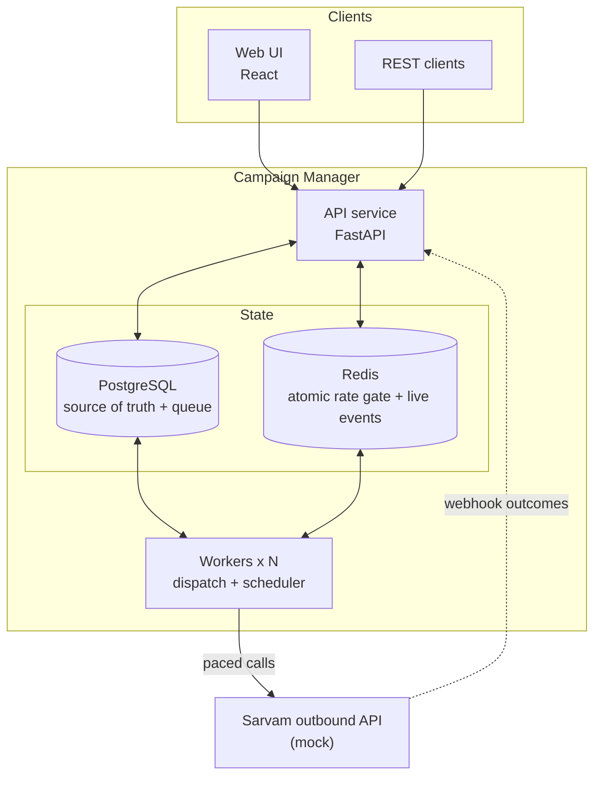

# Campaign Manager

A production-style manager for **outbound AI-agent voice campaigns**, built around Sarvam's outbound call API. You create a campaign, upload a cohort CSV that is validated against the agent's variables, set a calling window, pacing and retry rules, and press start. The system then places the calls, retries the ones that need it, and shows every contact's status live.

Two per-organisation limits hold at all times, however many workers run:

- **calls at the same time** (`max_concurrent_calls`), and
- **calls started per second** (`max_calls_per_second`), with no rolling one-second window ever above the limit.

Every feature works from the web UI and from the REST API. All calls go to a mock Sarvam server; no real phone calls are ever made.

## Quickstart

You only need [Docker Desktop](https://www.docker.com/products/docker-desktop/).

```bash
docker compose up --build
```

Then open **http://localhost:8080** and log in with one of the demo accounts:

| Role | Email | Password | Can do |
| --- | --- | --- | --- |
| Superadmin | `admin@example.com` | `admin12345` | Create organisations and set their limits |
| Org admin | `admin@acme.example.com` | `acme12345` | Everything inside "Acme Lending": workspaces, users, agents, connections, campaigns |
| Member | `agent@acme.example.com` | `acme12345` | Create and run campaigns in the workspaces they belong to |

The demo organisation "Acme Lending" (20 calls at once, 5 per second) comes with a workspace, an "EMI Reminder" agent and a connection with three caller numbers, so you can create a campaign straight away.

| Service | What it is | URL |
| --- | --- | --- |
| web | Web app | http://localhost:8080 |
| api | REST API with interactive docs | http://localhost:8000/api/docs |
| worker | Places calls and runs the scheduler (scale with `--scale worker=3`) | |
| mock-sarvam | Stand-in for Sarvam's outbound API, and the referee for the limits | http://localhost:9000/stats |
| postgres, redis | Database, and the rate gate plus live events (ports 5433 and 6380) | |
| migrate | Creates the schema and demo data, then exits | |

No `.env` file is needed. To change ports, secrets or the mock's behaviour, copy `.env.example` to `.env`.

## A five-minute tour

1. Log in as `admin@acme.example.com`.
2. **Agents** → "EMI Reminder" → **Download sample CSV**. The columns come from the agent's variables.
3. **Campaigns** → **New campaign**: pick the agent and connection, set attempts per second, retry rules and the calling window.
4. Upload the CSV. A dry run shows every problem by row and column before anything is imported (bad phone numbers, missing values, wrong types, duplicates). Fix it, or choose to skip invalid rows.
5. **Start**. The campaign page updates live: counts by status, a progress bar, a calls-per-second chart against the org limits, and each contact's attempts.
6. Try **Pause**: calls stop at once (nothing is queued ahead). **Resume** carries on, **Stop** cancels what's left.
7. As the superadmin, change Acme's limits while a campaign runs and watch the chart follow.

## Beyond the brief

- **Do Not Disturb list** per organisation (Settings, or `/api/v1/organizations/{id}/dnd`). Listed numbers are skipped at upload and can never be dialed, even if added later.
- **Check a CSV before creating anything**: the Recipients step validates against the agent (`POST /agents/{id}/validate-cohort`).
- **Export results** as CSV, **duplicate** a campaign, **cancel** a single contact.
- Live "calls in progress" history next to the calls-per-second chart, both against the org limits.

## Proving the limits

The mock Sarvam server records every request it receives, so it can act as an independent referee. One command creates a fresh organisation, runs a campaign through the whole stack, and compares what the mock saw with the limits:

```bash
make prove
```

or, with your own numbers:

```bash
docker compose exec api python -m app.tools.prove_limits --contacts 300 --concurrent 40 --cps 10
```

```
Measured by the mock Sarvam server (it saw every request):
  check                                limit  observed   result
  most calls live at once                 40        40   PASS
  most calls in any 1 s window            10        10   PASS
  calls placed (one per contact)         300       300   PASS
  campaign completed                         completed   PASS
```

It also passes with three workers and one of them killed mid-campaign, and with the mock injecting 503 errors and duplicate webhooks (`PATCH http://localhost:9000/config` with `{"fail_5xx_rate": 0.1, "webhook_dup_rate": 0.3}`). CI runs this check on every push.

## Using the API

Interactive docs: http://localhost:8000/api/docs. The spec is also in [`docs/api/openapi.json`](docs/api/openapi.json), and [`docs/api/campaign-manager.postman_collection.json`](docs/api/campaign-manager.postman_collection.json) imports straight into Postman (run "Log in" first; the token is saved for every other request).

A whole campaign from the command line:

```bash
API=http://localhost:8000/api/v1
TOKEN=$(curl -s $API/auth/login -H 'content-type: application/json' \
  -d '{"email":"admin@acme.example.com","password":"acme12345"}' | jq -r .access_token)
AUTH="Authorization: Bearer $TOKEN"

WS=$(curl -s $API/workspaces -H "$AUTH" | jq -r '.[0].id')
AGENT=$(curl -s $API/workspaces/$WS/agents -H "$AUTH" | jq -r '.[0].id')
CONN=$(curl -s $API/workspaces/$WS/connections -H "$AUTH" | jq -r '.[0].id')

curl -s $API/agents/$AGENT/sample-cohort.csv -H "$AUTH" > cohort.csv

CAMPAIGN=$(curl -s $API/workspaces/$WS/campaigns -H "$AUTH" -H 'content-type: application/json' -d '{
  "name": "November EMI reminders", "agent_id": "'$AGENT'", "connection_id": "'$CONN'",
  "attempts_per_second": 2,
  "calling_window": {"timezone": "Asia/Kolkata", "days": [1,2,3,4,5,6], "start": "09:00", "end": "21:00"}
}' | jq -r .id)

curl -s $API/campaigns/$CAMPAIGN/cohorts -H "$AUTH" -F file=@cohort.csv -F dry_run=true
curl -s $API/campaigns/$CAMPAIGN/cohorts -H "$AUTH" -F file=@cohort.csv
curl -s -X PUT $API/campaigns/$CAMPAIGN/status -H "$AUTH" -H 'content-type: application/json' -d '{"action":"start"}'

curl -s $API/campaigns/$CAMPAIGN/stats -H "$AUTH"
curl -s "$API/campaigns/$CAMPAIGN/contacts?limit=50" -H "$AUTH"
curl -sN $API/campaigns/$CAMPAIGN/events -H "$AUTH"
```

In order: the sample CSV for the agent (add your rows to it), a dry run that only checks the file, the real import, start, counts by status, the contacts page by page, and the live stream of updates (server-sent events).

Errors use `application/problem+json`. Validation errors list each problem as `{"field", "message"}`, and anything outside your organisation answers 404, so its existence isn't revealed.

## How it works



- **Postgres is the truth and the queue.** Contacts stay rows until the moment they are dialed (`FOR UPDATE SKIP LOCKED`). Nothing is queued ahead of time, so pause, stop and window changes take effect at once.
- **One atomic gate per call.** Before every call, a Redis Lua script checks, in one step and on Redis's clock: is the campaign still running, is the calling window open, is there room under the org's live-call limit, and when is the next free per-second slot for the org and for the campaign. Slots are spaced evenly with a 100 ms safety margin that absorbs network jitter, so the provider never counts more than the limit in any second.
- **A last check right before sending.** A second script runs at the slot time: still running, same version, on time, phone not already in a call. If it says no, the contact goes back untouched.
- **At most once per attempt.** A send marker written with `SET NX` races the crash reaper for the same key, so exactly one wins: an attempt is either provably never sent (and retried) or never sent again. Uncertain sends are settled by the webhook, which carries our attempt id and an HMAC signature, or by a timeout.
- **Retries are just rows with a new due time.** Each outcome (busy, no answer, short call, failed) has its own rule. Retries are moved into the next calling window and pass through the same gate, so they obey the same limits.
- **The scheduler reconciles.** Once a second, the leader worker compares what should be with what is: starts scheduled campaigns, finishes done ones, syncs states into Redis with version numbers (a slow writer can't undo a pause), reaps crashed workers' contacts, and retries webhooks that failed to process.

The full design, with the data model, state machines and failure cases, is in [`docs/02-architecture.md`](docs/02-architecture.md).

### What happens when things fail

| Failure | What the system does |
| --- | --- |
| A worker crashes mid-call | Its contacts are reaped after the lease. If the send marker shows the call was never sent, the contact is retried; if it may have been sent, we wait for the webhook. Never a blind re-dial. |
| Sarvam answers 503 or can't be reached | Not placed: the contact goes back and the org cools down for 2 s. |
| Sarvam answers another 5xx or times out | Maybe placed: never resent. The webhook or the lost-call timeout settles it. |
| 429 / 401 or 403 / other 4xx | Cool down / pause the workspace's campaigns / mark the attempt rejected (10 in a row pause the campaign). |
| A webhook arrives twice, late, or before we saved the dispatch | Stored with a dedupe key, applied once, in any order. |
| Redis restarts | The scheduler re-syncs every gate within a second. The first slot after a cold start is pushed 1 s out, so calls from just before the restart still count. |

## Deploying

`deploy/` runs the same stack on any Linux server, with Caddy in front for automatic HTTPS. Only ports 80 and 443 are open; the database, Redis, API and mock stay private. On a fresh Ubuntu server (Oracle Cloud's Always Free tier is enough):

```bash
git clone https://github.com/yshemashree/Campaign-Manager-Predixion-AI-.git
cd Campaign-Manager-Predixion-AI-
./deploy/setup.sh you@example.com
```

It installs Docker, writes `deploy/.env` with random secrets and a superadmin password, and serves the app at `https://<server-ip>.sslip.io`.

### Free hosting without a server

`deploy/huggingface/` packs the whole stack (Postgres, Redis, API, worker, mock Sarvam and the web app) into one container for a free Hugging Face Docker Space. Create a Space with the Docker SDK and upload `deploy/huggingface/Dockerfile` and `deploy/huggingface/README.md`; the build clones this repository. Data resets when the Space restarts, and the demo logins are seeded each time.

## Configuration

Every setting has a working default. The ones you might change (see `.env.example`):

| Variable | Default | Meaning |
| --- | --- | --- |
| `DISPATCH_SLOTS` | 32 | Calls each worker process can be placing at once |
| `WEBHOOK_TIMEOUT_S` | 300 | No outcome after this long: the attempt is marked lost |
| `MOCK_SPEED` | 10 | The mock's calls last 1/10 of real time, so demos finish in minutes |
| `MOCK_FAIL_5XX_RATE`, `MOCK_WEBHOOK_DROP_RATE`, `MOCK_WEBHOOK_DUP_RATE` | 0, 0, 0.05 | Fault injection in the mock (also changeable live with `PATCH /config`) |
| `JWT_SECRET`, `ENCRYPTION_KEY`, `WEBHOOK_SIGNING_SECRET` | dev values | Set real ones anywhere but your laptop |

## Project layout

```
backend/
  app/api/v1/      REST endpoints
  app/engine/      dispatcher, scheduler, Redis gate (lua/), Sarvam client
  app/domain/      pure logic: states, calling windows, retry policy, CSV validation
  app/services/    lifecycle transitions, cohort import, outcome handling
  app/models/      SQLAlchemy models; migrations/ has the schema
  app/tools/       prove_limits (load test), export_api (OpenAPI and Postman)
  tests/           unit/ (no database) and integration/ (real Postgres and Redis)
mock_sarvam/       mock of Sarvam's outbound API, with fault injection and the referee
frontend/          React web app
docs/              design documents, and api/ (OpenAPI spec, Postman collection)
```

## Development

Running tests and linters on your machine needs [uv](https://docs.astral.sh/uv/) (`brew install uv`).

| Command | What it does |
| --- | --- |
| `make up` | Start the stack and wait until healthy |
| `make test` | All tests (integration tests use Postgres and Redis from the stack) |
| `make test-unit` | Fast tests only, no database needed |
| `make lint` | Lint, format check and type check |
| `make prove` | Load test on the running stack, refereed by the mock |
| `make api-docs` | Regenerate `docs/api` |
| `make down` | Stop (keeps data); `make reset` also deletes data |

The integration tests use their own database and Redis DB, so they never touch your demo data. They include the engine running end to end (scheduler, two dispatchers, API and webhooks) against a fake Sarvam that measures the limits, and race tests for the gate: parallel reservers against the live-call cap, a pause landing between reserve and send, a stale scheduler write, the reaper racing a worker.

Health endpoints: `GET /healthz` says the process is alive. `GET /readyz` also checks Postgres and Redis, and returns 503 naming the failing dependency.

## Documentation

| # | Document | What's inside |
| --- | --- | --- |
| 1 | [Problem understanding](docs/01-problem-understanding.md) | The problem in plain words, glossary, requirements, what's hard, assumptions |
| 2 | [Architecture](docs/02-architecture.md) | High-level and low-level design: data model, state machines, dispatch pipeline, rate gate, windows, webhooks, retries, failure modes |
| 3 | [Tech stack and decisions](docs/03-tech-stack-decisions.md) | Each major choice against its alternatives, and when we'd choose differently |
| 4 | [Build plan](docs/04-build-plan.md) | Milestones, scope per day, acceptance checks, risks |
| 5 | [Research and approach](docs/05-research-and-approach.md) | How other platforms run campaigns and what I took from them |

## Main assumptions

- "Concurrency" means calls running at the same time (confirmed by the team). Calls per second is enforced as well, over any rolling second.
- Only the mock Sarvam is called. It speaks the same request and webhook format as Sarvam's outbound API.
- Calling windows are per campaign, in one timezone, on chosen weekdays. A retry that falls outside the window moves to the next opening.
- A phone number is never in two calls at once within an organisation.

The full list, with reasons, is in [`docs/01-problem-understanding.md`](docs/01-problem-understanding.md).
