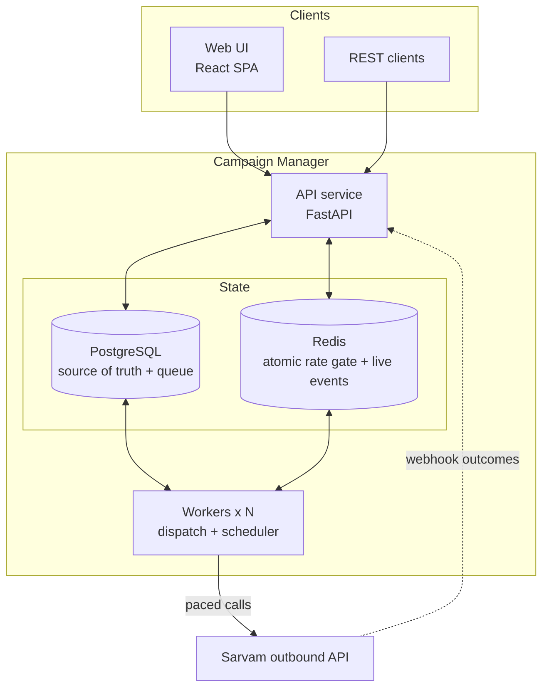

# Campaign Manager

A production-style manager for **outbound AI-agent voice campaigns**, built around Sarvam's single outbound-call API. It covers campaigns, cohort CSV uploads validated per agent, calling windows and schedules, retries, live per-contact status, multi-tenancy with roles, and a **hard per-organisation rate limit that holds across any number of workers**. Every feature is available from the web UI and from the REST API.

> **Status:** design phase complete (Day 0). Implementation follows the day-by-day plan in [`docs/04-build-plan.md`](docs/04-build-plan.md).

## Documentation

| # | Document | What's inside |
| --- | --- | --- |
| 1 | [Problem understanding](docs/01-problem-understanding.md) | The problem in plain words, actors, glossary, requirements, what's hard, **assumptions**, the four key questions |
| 2 | [Architecture](docs/02-architecture.md) | Design principles, high-level design, **low-level design** (data model, state machines, dispatch pipeline, rate gate, windows, webhooks, retries, failure modes) |
| 3 | [Tech stack and decisions](docs/03-tech-stack-decisions.md) | Every major choice compared with its alternatives: trade-offs accepted and when we'd choose differently |
| 4 | [Build plan](docs/04-build-plan.md) | Milestones, day-by-day scope, acceptance checks, risks |
| 5 | [Research and approach](docs/05-research-and-approach.md) | How other platforms run campaigns, what I took from them, the architecture in simple terms, assumptions, deliverables |

## Architecture in one picture



**The core ideas, briefly:**

- **Postgres is the truth and the queue.** Contacts stay rows until the moment they are dialed. Nothing is pre-queued, so pause, stop and window changes take effect immediately.
- **One atomic gate per dial.** A Redis Lua script checks campaign state, calling window, campaign pace and org pace together, using Redis's clock. Calls are spaced evenly, so no rolling second ever exceeds the org limit, however many workers run.
- **At most once per attempt.** Leases, send-intent markers and unique constraints mean a crash never causes a blind re-dial. Uncertain attempts are settled by the webhook (which carries our attempt id) or a timeout.
- **Retries are just rows with a new due time.** They are shifted into the calling window and pass through the same gate, so they obey the same limits.

## Planned quickstart

```bash
cp .env.example .env
docker compose up --build        # API, workers, web UI, Postgres, Redis, mock Sarvam
```

(Available from Day 1 onward.)
