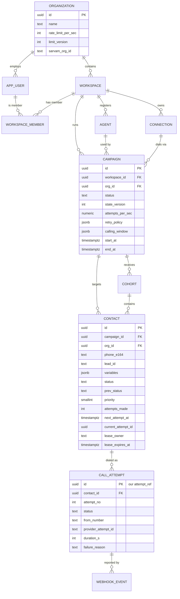
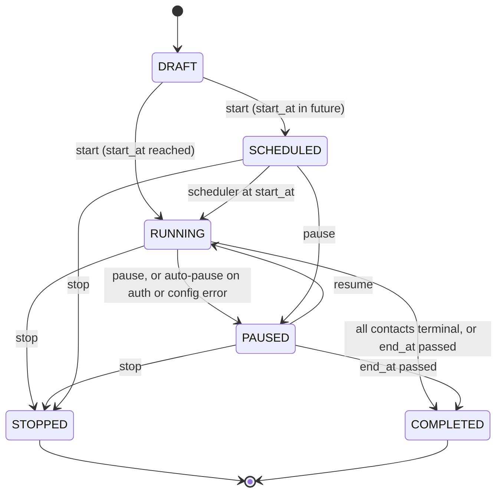
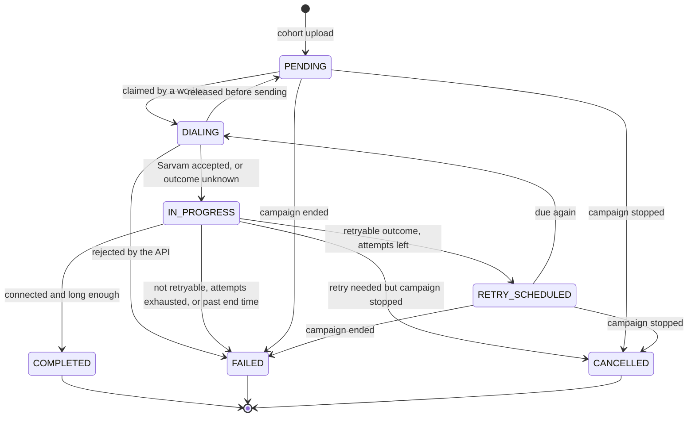
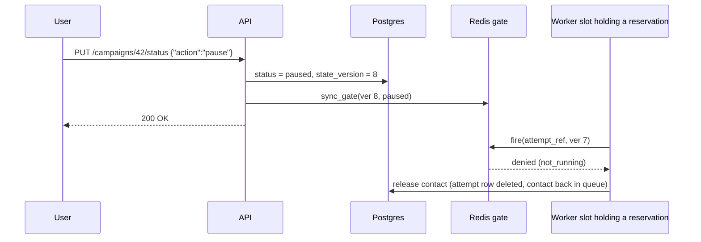
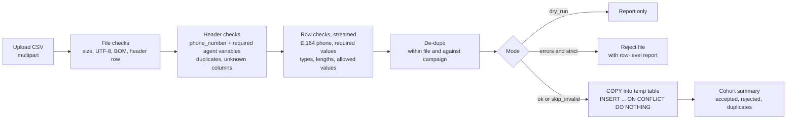

# 2. Architecture

> Part A is the **high-level design** (what the boxes are and how a call flows through them). Part B is the **low-level design** (tables, state machines, algorithms, scripts, failure handling). The "why this tech" comparison lives in `03-tech-stack-decisions.md`.

---

## 0. Seven design principles

The rest of the document follows from these. Most later sections trace back to one of them.

| # | Principle | What it buys us |
| --- | --- | --- |
| **P1** | **Postgres is the single source of truth. Redis holds only fast coordination state that can be rebuilt from Postgres.** | Losing Redis never loses business data; there is one place to look for "what is true". |
| **P2** | **Nothing is pre-queued. Each call is decided at the last possible moment** ("just-in-time dispatch"). Contacts stay rows in Postgres until a worker is about to dial them. | Pause, stop, window close and limit changes take effect immediately. There is no backlog that keeps calling people after a pause. |
| **P3** | **Every external call passes one atomic gate**: a Redis Lua script that checks campaign state, calling window, campaign pace and org pace together, using **Redis's clock**. | The org limit holds no matter how many workers or machines exist. No clock-skew bugs. |
| **P4** | **At most once per attempt.** We would rather lose an attempt than call a customer twice. Uncertainty is resolved by webhook or timeout, **never by blind re-sends**. | A clear, defensible answer to "can a customer be called twice?" |
| **P5** | **Every state change is a compare-and-set** (`UPDATE ... WHERE status = <expected>`). Duplicate or late events become no-ops. | Races resolve deterministically; webhooks and retries are idempotent. |
| **P6** | **Background loops are level-triggered and idempotent.** Every second, compare desired vs actual state and fix the difference. | A missed event or crashed process is healed on the next tick. Running two loops by accident is harmless. |
| **P7** | **Correctness never depends on a lock or a leader.** Locks only save work. | Lock expiry, split brain or GC pauses can cost efficiency, never correctness. |

---

# Part A: High-Level Design

## A.1 System context and components


| Component | Responsibility | How it scales | State it holds |
| --- | --- | --- | --- |
| **Web UI** | Every screen: orgs, workspaces, agents, campaigns, uploads, live dashboards. Only talks to the public API. | Static files (nginx/CDN) | None |
| **API service** | AuthN/AuthZ, tenant scoping, validation, CRUD, cohort ingestion, lifecycle actions, webhook intake, SSE streams, OpenAPI docs | Stateless replicas behind a load balancer | None (all in PG/Redis) |
| **Worker: dispatch slots** | Pick runnable campaign → reserve slot → claim contact → fire → call Sarvam → record result | Replicas × async slots per replica | None (leases live in PG) |
| **Worker: scheduler loop** | Start scheduled campaigns, open/close windows, keep gates in sync, finish campaigns, reap stuck work, re-run stalled webhooks | One active leader (Redis lock), the rest hot standby | None |
| **PostgreSQL** | Tenants, users, agents, campaigns, contacts (the queue), attempts, webhook events | Vertical → partitioning → sharding by org | **Durable truth** |
| **Redis** | Atomic rate gate, campaign gates (state, window, pace), send-intent markers, phone locks, leader lock, pub/sub | One primary (+ replica); cluster-ready (keys hash-tagged per org) | **Ephemeral, rebuildable** |
| **mock-sarvam** *(dev/demo only)* | Same contract as Sarvam. Simulates outcomes, sends webhooks, injects faults, and **independently measures the per-org request rate** | n/a | In-memory |

**Why only two process types (API + worker)?** This is a **modular monolith**: one codebase and one domain model, split into processes only where the runtime profile differs. Request/response work stays in the API; long-running loops go in the worker. Microservices would add network hops, distributed transactions and deployment overhead with no benefit at this scale (see `03` → D1).

## A.2 The life of one call (end to end)

1. **Create.** A user creates a campaign (`DRAFT`) and uploads a cohort. Each CSV row becomes a `contacts` row with status `pending`.
2. **Start.** The user presses Start. The campaign becomes `RUNNING` (or `SCHEDULED` until its start time). The API writes Postgres first, then the campaign's **gate** in Redis (`state=running`, version, pace, window end).
3. **Window opens.** Every second the scheduler computes "are we inside the calling window, and until when?" It writes `window_until` into the gate and lists the campaign as *runnable*.
4. **Reserve.** A worker slot picks the campaign (round-robin) and asks the gate for a **send slot**. The reply is *"granted: send at +140 ms"* or *"denied: try in 300 ms"*.
5. **Claim.** The slot locks the next due contact in Postgres (`FOR UPDATE SKIP LOCKED`, so workers never block or collide) and creates **attempt #k** in the same transaction.
6. **Fire.** The slot sleeps until its slot time, then runs the **fire check**. In one atomic step this asks: still running? window still open? on time? phone not busy in another campaign? If all pass, it writes a **send-intent marker**.
7. **Call Sarvam.** The slot POSTs to Sarvam with `metadata = {lead_id, attempt_ref, sig}`, stores Sarvam's `attempt_id`, and marks the contact `in_progress`.
8. **Outcome.** Sarvam calls the customer. When the call ends it POSTs our webhook. The API verifies the signature, de-duplicates, and in one transaction updates the attempt and the contact: `completed`, `retry_scheduled` (next time shifted into the window) or `failed`.
9. **Live.** An event goes out on Redis pub/sub. Every API instance with a browser watching that campaign pushes it over SSE, so the dashboard updates within a second.
10. **Finish.** When every contact is terminal (or the end time passes), the scheduler marks the campaign `COMPLETED`.

## A.3 How the design meets the non-functional goals

| Goal | Mechanism |
| --- | --- |
| **High concurrency** | Stateless API replicas. Workers run hundreds of async slots each and scale with `--scale worker=N`. `SKIP LOCKED` lets any number of workers dequeue without blocking each other. Gate decisions are O(1) in Redis. |
| **Low latency** | A dispatch decision is one Redis round-trip (~sub-ms) plus one indexed Postgres transaction (~ms). Slots are **reserved**, not polled, so there is no thundering herd. UI updates are pushed (SSE), not polled. Webhooks are acknowledged after a single insert. |
| **Accuracy (rate)** | One atomic gate, one clock (Redis `TIME`), evenly spaced slots, a safety margin for jitter, and a late-fire cutoff. Proven by an independent referee in mock-sarvam. |
| **Accuracy (state)** | Postgres transactions, compare-and-set transitions, unique constraints (`contact_id, attempt_no`), idempotent webhooks, versioned gate writes, and reconcile loops. |
| **Availability** | Any process can die at any instant. Leases plus reapers recover work, a standby takes over the scheduler, and Redis loss fails *closed* and rebuilds itself. |
| **Fairness** | Round-robin across campaigns at the slot level. Each org is paced independently, so one org's huge campaign can't consume another org's budget. A campaign that is pacing itself never blocks its siblings (§B.5). |
| **Isolation** | Every query is tenant-scoped (org → workspace). IDs from another org return 404. Secrets are encrypted per workspace. |

### Capacity estimate (design target, not the demo size)

| Quantity | Estimate | Headroom |
| --- | --- | --- |
| Peak dial rate | 1,000 dials/s across all orgs | Sarvam's own campaign max is 500/s per campaign |
| Postgres writes per dial | ≈4 (claim txn, dispatch record, webhook insert, webhook apply) → ~4,000/s | Well within one tuned Postgres node (order of 10k simple writes/s) |
| Redis operations per dial | ≈3 script calls + 1 publish → ~4,000/s | Redis handles 100k+ simple ops/s on one core |
| In-flight senders (Little's law: concurrency = rate × latency) | 1,000/s × (≤1 s slot wait + ~0.5 s API latency) ≈ 1,500 | 3 workers × 500 async slots |
| Webhooks | ~1,000/s | 2–4 API replicas |
| Storage | ~1 KB/contact + ~0.5 KB/attempt incl. indexes → 1M contacts ≈ 1.5–2 GB | Trivial |

The real ceiling is **Sarvam's rate limit, not our CPU**. That is why language speed was not the deciding factor in `03`.

---

# Part B: Low-Level Design

## B.1 Code layout

```
backend/
  app/
    main.py              # FastAPI app factory: routers, middleware, error handlers
    worker.py            # worker entrypoint: N dispatch slots + scheduler loop
    core/                # config, db engine, redis, security (JWT, argon2, AES-GCM), logging, errors
    domain/              # PURE logic, no I/O, heavily unit-tested:
      states.py          #   transition tables for campaign / contact / attempt
      windows.py         #   calling-window maths (tz, DST, next_allowed, window_end)
      retry_policy.py    #   outcome → (retry? when?) decisions
      outcomes.py        #   Sarvam webhook → our outcome classification
      cohort_schema.py   #   agent variables → CSV validators
    models/              # SQLAlchemy tables
    schemas/             # Pydantic request/response models (these generate the OpenAPI spec)
    repositories/        # tenant-scoped data access; hot-path SQL is hand-written
    services/            # use cases: campaigns, lifecycle, cohorts, webhooks, stats
    api/v1/              # thin routers: parse → call service → respond
    engine/
      gate.py            # Python wrapper around the Lua scripts
      lua/               # reserve.lua, fire.lua, refund.lua, sync_gate.lua
      dispatcher.py      # the slot loop
      scheduler.py       # leader election + reconcile tick
      reaper.py          # stuck leases, lost webhooks
      sarvam_client.py   # payload builder + HTTP + error classification
      events.py          # publish after commit / subscribe for SSE
  migrations/            # Alembic
  tests/                 # unit / integration / e2e
mock_sarvam/             # contract-compatible fake + rate referee
frontend/                # React + Vite + TypeScript
docker-compose.yml
```

**Rule of thumb:** `domain/` knows nothing about HTTP, SQL or Redis, so the hardest logic (windows, retries, transitions) is tested with plain unit tests. Routers are thin, so the UI and REST clients go through exactly the same code path (requirement F7).

## B.2 Data model



### Tables (key columns only)

| Table | Purpose | Notable columns |
| --- | --- | --- |
| `organizations` | Tenant | `rate_limit_per_sec`, `limit_version` (bumped on every limit change), `sarvam_org_id`, `status` |
| `workspaces` | Team space | `org_id`, `sarvam_workspace_id`, `sarvam_api_key_enc` (AES-GCM), `api_key_last4` |
| `app_users` | Login identity | `email` (unique), `password_hash` (argon2id), `role` (superadmin / org_admin / member), `org_id` (null for superadmin) |
| `workspace_members` | Member → workspace access | PK (`user_id`, `workspace_id`) |
| `agents` | Registered Sarvam agent | `app_id`, `app_version`, `variables` JSONB: `[{name, type, required, example, max_length, allowed}]`, default `app_overrides` |
| `connections` | Telephony connection | `connection_id`, `caller_numbers text[]` |
| `campaigns` | The job definition | `status`, `state_version`, `attempts_per_sec`, `caller_numbers text[]`, `retry_policy` JSONB, `calling_window` JSONB `{timezone, days[], start, end}`, `start_at`, `end_at`, `app_overrides`, `pause_reason` |
| `cohorts` | One upload | `filename`, `rows_total`, `rows_accepted`, `rows_rejected`, `status`, `error_report` |
| `contacts` | **The unit of work and the queue** | `status`, `prev_status`, `priority` (0 = due retry, 1 = fresh), `next_attempt_at`, `attempts_made`, `current_attempt_id`, `lease_owner`, `lease_expires_at`, `last_outcome`, `final_reason` |
| `call_attempts` | One dial | `id` (= `attempt_ref` we send in metadata), `attempt_no`, `status`, `from_number`, `provider_attempt_id`, `dispatched_at`, `ended_at`, `duration_s`, `failure_reason`, `http_status` |
| `webhook_events` | Raw inbound webhooks (audit + idempotency) | `dedupe_key` (unique), `attempt_ref`, `payload` JSONB, `received_at`, `processed_at`, `error` |
| `audit_log` | Who did what | `actor_id`, `action`, `entity`, `before`/`after` JSONB |

### Constraints and indexes that carry correctness or speed

```sql
-- One phone number once per campaign (de-dupe at upload time, enforced by the DB)
ALTER TABLE contacts ADD CONSTRAINT uq_contact_phone UNIQUE (campaign_id, phone_e164);

-- An attempt number can exist only once per contact: the last line of defence against double dispatch
ALTER TABLE call_attempts ADD CONSTRAINT uq_attempt_no UNIQUE (contact_id, attempt_no);

-- THE QUEUE INDEX: small, partial, ordered exactly like the claim query
CREATE INDEX ix_contacts_due ON contacts (campaign_id, priority, next_attempt_at, id)
  WHERE status IN ('pending', 'retry_scheduled');

-- Live counters and filtered contact lists
CREATE INDEX ix_contacts_status ON contacts (campaign_id, status);

-- Reaper scans
CREATE INDEX ix_contacts_lease ON contacts (lease_expires_at) WHERE status = 'dialing';
CREATE INDEX ix_attempts_open  ON call_attempts (dispatched_at) WHERE status IN ('dispatched', 'unknown');

-- Webhook idempotency
ALTER TABLE webhook_events ADD CONSTRAINT uq_webhook_dedupe UNIQUE (dedupe_key);
```

**IDs:** UUIDv7 (time-ordered) for every public id. They insert in order, which keeps B-tree indexes compact, and they aren't guessable, so ids can't be enumerated across tenants. `org_id` is denormalised onto campaigns, contacts and attempts so tenant filters and per-org gate keys never need a join.

## B.3 State machines

### Campaign



- Every transition is one conditional update that also bumps `state_version`:
  `UPDATE campaigns SET status = :to, state_version = state_version + 1 WHERE id = :id AND status = ANY(:allowed_from) RETURNING state_version`.
  Zero rows means either an idempotent repeat (already in the target state, so return 200) or an illegal move (409).
- `RUNNING` + outside the window is shown in the UI as **"Waiting for window (opens Mon 09:00 IST)"**. It is *derived*, not stored, so there is no extra state to keep consistent.
- Resuming a campaign whose `start_at` is still in the future returns it to `SCHEDULED`.
- Editable while `DRAFT`, `SCHEDULED` or `PAUSED`: pace, retry rules, window, end time, caller numbers. Agent and connection are frozen once contacts exist, because the cohorts were validated against that agent's variables.

### Contact



"Released before sending" restores `prev_status` (`pending` or `retry_scheduled`) and keeps `next_attempt_at`, so the contact loses nothing. The UI maps `DIALING` and `IN_PROGRESS` to **in progress** and `RETRY_SCHEDULED` to **retrying**. **Attempts made** is `attempts_made`.

### Attempt

| Status | Meaning | Terminal? |
| --- | --- | --- |
| `reserved` | Row created at claim time; not yet sent. If released, the row is **deleted** (it never happened) | no |
| `dispatched` | Sarvam answered 2xx and gave us its `attempt_id` | no |
| `unknown` | Request may have been sent but we have no definitive answer (timeout, 5xx, worker died after the send marker) | no |
| `completed` / `busy` / `no_answer` / `short_call` / `failed` | Outcome from the webhook | yes |
| `rejected` | Sarvam answered 4xx (bad request); the call wasn't placed | yes |
| `lost` | Sent (or maybe sent), no webhook within the timeout (default 15 min) | yes |

## B.4 The dispatch pipeline (worker slot loop)

Each worker process runs `DISPATCH_SLOTS` (default 64) copies of this coroutine:

```python
async def slot_loop(worker):
    while not worker.stopping:
        campaign = worker.runnable.next()                  # local round-robin over runnable campaigns
        if campaign is None:
            await worker.wakeup.wait(timeout=1.0)
            continue

        grant = await gate.reserve(campaign)               # (1) Lua: state, window, campaign pace, org pace
        if not grant.ok:
            worker.runnable.cool_down(campaign, grant.retry_after_ms)
            continue

        claim = await repo.claim_next(campaign, worker.id, grant.from_number)   # (2) one txn, SKIP LOCKED
        if claim is None:                                  # nothing due right now
            await gate.refund(grant)
            worker.runnable.mark_empty(campaign)
            continue

        await sleep_ms(grant.delay_ms)                     # (3) wait for our exact slot (at most ~1 s)

        verdict = await gate.fire(grant, claim)            # (4) Lua: last check + send-intent marker
        while verdict.reason == "early":                   #     woke a hair too soon: wait the remainder
            await sleep_ms(verdict.retry_after_ms)
            verdict = await gate.fire(grant, claim)
        if not verdict.ok:                                 # paused / stopped / window closed / late / phone busy / revoked
            await repo.release(claim, verdict.reason)      # back to the queue (compare-and-set: no-op if the reaper got there first)
            continue

        result = await sarvam.place_call(build_payload(campaign, claim))   # (5) the only external call
        await repo.record_dispatch(claim, result)          # (6) compare-and-set; webhook may already be here
```

Why this order?

- **Reserve before claim:** we only lock a contact when we already have a slot for it, so contacts aren't held hostage while a busy org waits for capacity.
- **Claim before sleep:** the database work happens *before* the slot time. Between "slot reached" and "bytes on the wire" there is only one Redis call, which keeps send-time jitter tiny.
- **Fire check at the last moment:** this is what makes pause, stop and window close exact (§B.10).

## B.5 The rate gate: how the org limit is guaranteed

### Why the obvious approaches fail

| Approach | What goes wrong |
| --- | --- |
| Limiter inside each worker | 3 workers × "5/s" = 15/s. Budgets add up. |
| Fixed window counter ("5 per calendar second") | 5 calls at 0.99 s + 5 at 1.01 s = **10 calls within 20 ms**. |
| Token bucket with burst = N | Full bucket (5) plus refill during the same second ⇒ up to ~2N in a rolling second. |
| Rely on Sarvam's 429s | Every rejected request **is still a hit**, so the requirement is already broken. |
| Sliding-window log | Exact, but grants arrive in bursts (5 at once). Polling clients cause a thundering herd. |
| **GCRA (evenly spaced slots) + reservations** ✅ | Exact, O(1) memory, smooth pacing that any downstream limiter accepts, no polling. |

### The idea in plain words

A ticket counter. For an org with limit N, the counter hands out **send times spaced T = 1000/N ms apart** (5/s → one every 200 ms). A worker asks for a ticket and is told *"your slot is at 12:00:00.400"*. It sleeps until then and sends. The counter (Redis) is shared by every worker on every machine, and it hands out tickets atomically, so two workers can never get the same slot.

**Proof that it holds:** consecutive grants are at least T apart, so any half-open 1-second interval `[t, t+1000)` can contain at most `1000 / T = N` grants. ∎

### Jitter: making the guarantee hold at Sarvam's door, not just ours

A send can happen slightly *after* its slot (event-loop lag; the fire check rejects anything more than `L` ms late), and network delay varies by up to `J` ms. If two sends move closer together than T, Sarvam could see N+1 calls in a rolling second. So we pace with a **safety margin M ≥ L + J**:

```
T = (1000 + M) / N            -- M = RATE_MARGIN_MS (default 50), L = LATE_TOLERANCE_MS (default 20)
```

For any N+1 consecutive arrivals, `span ≥ N·T − L − J ≥ 1000 + M − M = 1000 ms`, so **no rolling second ever contains more than N calls**. The cost is about 5% throughput (4.76/s instead of 5/s). That trade is explicit and configurable: with `M = 0` you get exactness at our side only.

### Two levels in one atomic step

Each dial must satisfy **both** the campaign's own pace (APS) **and** the org's pace. Both are checked and updated in the same Lua script, so they can never disagree. One rule prevents head-of-line blocking: if the *campaign* isn't ready at the org's next free slot, we **deny without touching the org schedule**. Another campaign can then take that slot, so a slow campaign never wastes its org's budget.

### `reserve.lua` (outline)

```lua
-- KEYS[1] = {o:<org>}:gate        hash: limit, tat, cooldown_until, limit_ver
-- KEYS[2] = {o:<org>}:c:<camp>    hash: state, ver, window_until, aps, tat, rr
-- ARGV[1] = horizon_ms (1000)     ARGV[2] = margin_ms (50)
local t   = redis.call('TIME')                                    -- ONE clock for every worker
local now = tonumber(t[1]) * 1000 + math.floor(tonumber(t[2]) / 1000)

local c = redis.call('HMGET', KEYS[2], 'state', 'window_until', 'aps', 'tat', 'ver')
if c[1] ~= 'running' then return {0, 'not_running', 0} end
local window_until = tonumber(c[2]) or 0
if now >= window_until then return {0, 'window_closed', 0} end

local o = redis.call('HMGET', KEYS[1], 'limit', 'tat', 'cooldown_until', 'limit_ver')
local limit = tonumber(o[1]) or 0
if limit <= 0 then return {0, 'org_disabled', 0} end              -- missing key => fail closed

local margin = tonumber(ARGV[2])
local t_org  = (1000 + margin) / limit
local t_camp = (1000 + margin) / tonumber(c[3])

local slot  = math.max(now, tonumber(o[2]) or 0, tonumber(o[3]) or 0)  -- next free org slot
local ready = math.max(now, tonumber(c[4]) or 0)                       -- campaign's own pace
if ready > slot then return {0, 'campaign_pace', ready - now} end      -- don't block the org
if slot - now > tonumber(ARGV[1]) then return {0, 'org_pace', slot - now} end
if slot >= window_until then return {0, 'window_closed', 0} end

redis.call('HSET', KEYS[1], 'tat', slot + t_org)                       -- book the org slot
redis.call('HSET', KEYS[2], 'tat', slot + t_camp)                      -- and the campaign slot
local rr = redis.call('HINCRBY', KEYS[2], 'rr', 1)                     -- caller-number round-robin
return {1, tostring(slot), slot - now, c[5], o[4], rr}
```

- **Horizon (1 s):** a slot can be booked at most 1 s ahead. That bounds outstanding reservations (≈ N per org) and how long a pause has to "catch" sleepers.
- **Refund (`refund.lua`):** if the claim found no contact, we give the slot back, but only if nobody booked after us (`tat == slot + T`). Otherwise it is a harmless gap.
- **Cooldown:** a 429 or a run of 5xx from Sarvam sets `cooldown_until`, which pushes the org's next slot back (a circuit breaker).

### `fire.lua` (the last-moment check)

```lua
-- KEYS: campaign gate, org gate, phone lock {o:<org>}:ph:<e164>, send marker {o:<org>}:sent:<attempt_ref>, rate counter
-- ARGV: slot_ms, late_tolerance_ms, attempt_ref, campaign_ver, limit_ver, lock_ttl_s
now = TIME
if campaign.state ~= 'running' or campaign.ver ~= ARGV.campaign_ver   -> deny 'not_running'   (pause/stop since reserve)
if now >= campaign.window_until                                       -> deny 'window_closed'
if now <  slot                                                        -> deny 'early' (sleep the remainder, retry)
if now >  slot + late_tolerance                                       -> deny 'late'           (never send late)
if org.limit_ver ~= ARGV.limit_ver                                    -> deny 'limit_changed'  (re-reserve at the new pace)
if phone lock held by another attempt                                 -> deny 'phone_busy'     (other campaign is calling them)
if SET send marker = 'sent' NX EX 86400 fails                         -> deny 'revoked'        (the reaper already took this attempt back)
SET phone lock = attempt_ref EX lock_ttl
HINCRBY rate counter <second>                                         -- feeds the live rate chart
return ok
```

The send marker is written with **`SET ... NX`** (only if absent). The reaper uses the same key, writing `revoked` with `NX` before it re-queues a stuck contact (§B.9). Whoever writes the key first wins, so a worker that froze past its lease can never send an attempt the reaper has already handed back. This is a *fencing* check, so correctness doesn't depend on lease timing (P7).

All keys of one org share the hash tag `{o:<org>}`, so every script touches a single Redis Cluster slot and stays cluster-safe.

## B.6 Claiming a contact (Postgres as a queue)

```sql
BEGIN;
-- 1) the next due contact that no other worker holds (others skip it instead of waiting)
SELECT id, phone_e164, lead_id, variables, attempts_made, status
FROM contacts
WHERE campaign_id = $1
  AND status IN ('pending', 'retry_scheduled')
  AND next_attempt_at <= now()
  AND EXISTS (SELECT 1 FROM campaigns k        -- Postgres must agree the campaign is running,
              WHERE k.id = $1                  -- at the same version the gate granted under
                AND k.status = 'running'
                AND k.state_version = $granted_version)
ORDER BY priority, next_attempt_at, id          -- due retries first, then oldest
LIMIT 1
FOR UPDATE SKIP LOCKED;

-- 2) mark it as being dialed, with a lease the reaper can check
UPDATE contacts
SET status = 'dialing', prev_status = status, attempts_made = attempts_made + 1,
    current_attempt_id = $attempt_ref, lease_owner = $worker_id,
    lease_expires_at = now() + interval '60 seconds', updated_at = now()
WHERE id = $contact_id;

-- 3) reserve the attempt row (UNIQUE (contact_id, attempt_no) is the backstop)
INSERT INTO call_attempts (id, contact_id, campaign_id, org_id, attempt_no, status, from_number)
VALUES ($attempt_ref, $contact_id, $1, $org_id, $attempts_made_plus_1, 'reserved', $from_number);
COMMIT;
```

- **`SKIP LOCKED`** is the key to concurrency. Ten workers asking at once get ten *different* contacts instead of queueing behind one row lock.
- The partial index `ix_contacts_due` matches the `WHERE` + `ORDER BY` exactly, so this is an index range scan that stops at the first unlocked row.
- **Campaign guard (`EXISTS ...`):** a claim only succeeds if Postgres agrees the campaign is `running` at the exact version the gate granted under. This is the database half of pause/stop safety (§B.10). It costs one primary-key lookup.
- **Why due retries first (`priority`)?** If fresh contacts always came first, a 30-minute "no answer" retry in a 2-hour campaign would really happen after 2 hours. Retries are time-sensitive and bounded by max attempts, so they can't starve fresh contacts.
- **Lock order rule:** code that touches both rows always locks **attempt → contact** (webhook handler, recorder, reaper), so these paths can't deadlock.

**`release`** (never sent): delete the `reserved` attempt row and restore `prev_status`, `attempts_made - 1`, and clear the lease. Guard: `WHERE status = 'dialing' AND current_attempt_id = $attempt_ref`. For `phone_busy` we also push `next_attempt_at` 5 minutes out.

**`record_dispatch`** (after HTTP) is all compare-and-set, because the webhook can beat us here:

```sql
UPDATE call_attempts SET status = 'dispatched', provider_attempt_id = $pid, dispatched_at = now()
 WHERE id = $attempt_ref AND status IN ('reserved', 'unknown');        -- no-op if webhook already finalised it
UPDATE contacts SET status = 'in_progress', lease_owner = NULL, lease_expires_at = NULL
 WHERE id = $contact_id AND status = 'dialing' AND current_attempt_id = $attempt_ref;
```

## B.7 Calling windows (time maths)

Stored per campaign: `calling_window = {timezone: "Asia/Kolkata", days: [1..7 ISO], start: "09:00", end: "18:00"}`, plus `start_at` / `end_at` (UTC instants).

Two pure functions in `domain/windows.py` do all the work:

```python
def window_end(now_utc, cw, start_at, end_at) -> datetime | None:
    """If `now` is inside an allowed window, return when that window closes (capped by end_at); else None."""

def next_allowed(t_utc, cw, start_at, end_at) -> datetime | None:
    """Earliest instant >= t that is inside an allowed window and before end_at; None if there is none."""
    # walk at most 8 local days forward: skip disallowed weekdays, clamp to [start, end) local time,
    # convert local -> UTC with zoneinfo (DST gaps and overlaps resolved by the tz database)
```

- The **scheduler** uses `window_end` every second to write `window_until` (epoch ms) into the campaign gate. The gate compares it with Redis time, so **windows close with millisecond precision**, not "at the next tick".
- **Retries** use `next_allowed(now + delay)`. A retry computed for 19:30 in a 09:00–18:00 window lands at 09:00 on the next allowed day. A `None` result means "past the end time", so the contact fails with `campaign_ended`.
- **Property tests** (Hypothesis) generate random timezones, weekday sets and times and check the invariants: the result is ≥ t, inside the window, minimal, and never past `end_at`. Fixed tests cover DST transitions (e.g. `America/New_York` in March and November).

## B.8 Webhooks, outcomes and retries

### Building the request (the only external call)

```json
{
  "app_config": {
    "app_id": "<agent.app_id>", "app_version": 7, "app_type": "agent",
    "connection_config": { "connection_id": "<connection_id>", "agent_phone_number": "<caller number, round-robin>" },
    "agent_variables": { "...": "values from the contact's CSV row" },
    "app_overrides": { "initial_bot_message": "...", "initial_state_name": "..." }
  },
  "user_config": { "user_phone_number": "<contact.phone_e164>" },
  "webhook_config": {
    "url": "<PUBLIC_BASE_URL>/api/v1/webhooks/sarvam",
    "metadata": { "lead_id": "<contact.lead_id>", "attempt_ref": "<call_attempts.id>", "sig": "<HMAC-SHA256(secret, attempt_ref)>" }
  }
}
```

`attempt_ref` is generated **by us, before sending**, so a webhook can be matched to its attempt even if the worker died before saving Sarvam's response. `sig` authenticates the webhook, because Sarvam doesn't document webhook signing.

### Classifying the outcome

| Sarvam `status` | `duration` | Our outcome | Default retry rule |
| --- | --- | --- | --- |
| `connected` | ≥ short-call threshold | `completed` | none, the contact is done |
| `connected` | < threshold | `short_call` | retry after delay |
| `busy` | n/a | `busy` | retry after delay |
| `no_answer` | n/a | `no_answer` | retry after delay |
| `failed` | n/a | `failed` | configurable (default off: often NDNC or invalid number) |
| *(no webhook within 15 min)* | n/a | `lost` | follows the `failed` rule |

### Webhook handler

```
POST /api/v1/webhooks/sarvam
 1. Parse leniently; read metadata.attempt_ref and metadata.sig; verify the HMAC (bad sig → 401).
 2. INSERT INTO webhook_events (dedupe_key = hash(attempt_ref, status, duration), payload)
    ON CONFLICT DO NOTHING        → already seen? return 200 immediately.
 3. One transaction:
      lock attempt FOR UPDATE      → already terminal? mark event processed, done (late duplicate).
                                     (exception: a `lost` attempt records its real outcome; if the contact is still
                                      waiting in retry_scheduled for that retry, re-decide, e.g. completed ⇒ cancel the retry)
      attempt ← outcome, duration, failure_reason, provider_attempt_id
      lock contact FOR UPDATE      → decide(contact, outcome, policy, campaign) → completed | retry_scheduled | failed | cancelled
      UPDATE contact ... WHERE current_attempt_id = attempt_ref    (compare-and-set)
      webhook_events.processed_at = now()
 4. After commit: release the phone lock (only if it still holds this attempt_ref), publish a live event, return 200.
    If step 3 throws, the raw event is already stored, so the scheduler's sweeper re-runs it.
```

### The retry decision (`domain/retry_policy.py`)

```python
def decide(outcome, attempts_made, policy, campaign, now):
    if outcome == "completed":                      return Completed()
    rule = policy.rules.get(outcome)                # busy / no_answer / short_call / failed (lost → failed)
    if rule is None or not rule.enabled:            return Failed(reason=outcome)
    if attempts_made >= policy.max_attempts:        return Failed(reason="max_attempts_reached")
    if campaign.status == "stopped":                return Cancelled(reason="campaign_stopped")
    delay = rule.delay * (policy.backoff ** (attempts_made - 1))      # backoff = 1 means fixed delay
    when = next_allowed(now + delay, campaign.window, campaign.start_at, campaign.end_at)
    if when is None:                                return Failed(reason="campaign_ended")
    return RetryScheduled(next_attempt_at=when, priority=0)
```

Retry policy shape, stored as JSONB on the campaign and validated by Pydantic:

```json
{
  "max_attempts": 3,
  "short_call_threshold_s": 10,
  "backoff": 1.0,
  "rules": {
    "busy":       { "enabled": true,  "delay_s": 600 },
    "no_answer":  { "enabled": true,  "delay_s": 1800 },
    "short_call": { "enabled": true,  "delay_s": 3600 },
    "failed":     { "enabled": false, "delay_s": 900 }
  }
}
```

**Retries vs. limit:** a retry is the same contact row with a new `next_attempt_at`. It is claimed by the same query and passes through the **same gate**, so it consumes the same org budget. No separate retry path exists that could bypass the limit.

## B.9 The scheduler (reconcile loop) and the reaper

Every worker runs the scheduler loop, but only the holder of the Redis lock `scheduler:leader` acts (`SET NX PX 5000`, renewed every tick with a compare-and-extend script). Each tick (1 s):

| Step | What it does | Why it is safe to repeat |
| --- | --- | --- |
| 1. Activate | `SCHEDULED` campaigns with `start_at <= now` → `RUNNING` | conditional update |
| 2. Sync gates | For each `RUNNING` campaign: compute `window_until` and whether any contact is due; write the campaign gate with `sync_gate.lua` (**versioned**, see §B.10); publish the runnable map | stale writers are rejected by version |
| 3. Sync orgs | Write `limit`, `limit_ver` into org gates. **Cold-start guard:** if an org gate was missing (Redis restarted), set `tat = now + 1000 ms`, so calls sent just before the restart are still accounted for | idempotent |
| 4. Finish | Past `end_at` → `COMPLETED`; `RUNNING` with zero non-terminal contacts → `COMPLETED` | conditional update |
| 5. Finalise | For `STOPPED` / `COMPLETED` campaigns, move remaining `pending` / `retry_scheduled` contacts to `cancelled` / `failed(campaign_ended)` in **batches of 5,000**, so stopping a 1M-row campaign never holds one giant transaction | batched, conditional |
| 6. Reap leases | `dialing` contacts with expired leases: try `SET send marker = 'revoked' NX`. **Succeeded** ⇒ never sent, and now it never can be ⇒ `release` (free retry). **Failed because the marker says `sent`** ⇒ maybe sent ⇒ attempt `unknown`, contact `in_progress`, wait for webhook | the marker decides atomically; nothing is ever re-sent |
| 7. Reap lost | Attempts `dispatched` / `unknown` older than `WEBHOOK_TIMEOUT` (15 min) → `lost`, release the phone lock → retry policy | conditional update |
| 8. Sweep webhooks | Re-process `webhook_events` with `processed_at IS NULL` older than 30 s | handler is idempotent |

Workers refresh the **runnable map** every 500 ms and round-robin over it locally (each worker starts at a random offset). Gate denials put a campaign on a short local cool-down, so slots don't hammer it.

## B.10 Lifecycle actions and the versioned gate

`PUT /api/v1/campaigns/{id}/status` with `{"action": "start" | "pause" | "resume" | "stop"}`. The flow is the same for every action:

1. **Postgres first:** conditional transition + `state_version + 1` (§B.3).
2. **Then Redis:** `sync_gate.lua(ver, state, aps, window_until)`, which **refuses writes with an older version than the stored one**.
3. Publish `campaign.updated`, then respond.

**Why the version matters.** Consider this race: the scheduler reads "running, v7" → a user pauses (DB v8, Redis v8 "paused") → the scheduler writes "running, v7" to Redis. Without versions, the campaign would silently un-pause. With versions, the stale v7 write is rejected. This is the classic *fencing token* pattern.



**Two independent guards.** A send needs Postgres to say "running, version v" at **claim** time (§B.6) **and** Redis to say "running, version v" at **fire** time. Even if Redis were briefly unavailable or stale during a pause, the database guard alone stops new claims.

**Guarantee:** once the pause/stop API has responded, no new request for that campaign leaves any worker. A send either passed `fire` *before* the gate flipped (it was already in flight) or it is denied. Calls already on the phone finish, and their webhooks are still processed. Retries computed during a pause are stored and become due after resume.

**Auto-pause:** a 401/403 from Sarvam pauses every running campaign of that workspace (`pause_reason = auth_error`). Ten consecutive 4xx rejections in one campaign pause it (`pause_reason = config_error`). This stops one bad config from burning a whole cohort.

## B.11 Live status

- **Events:** after each commit we publish compact JSON (`contact.updated`, `campaign.updated`, `stats`) to Redis channels `ev:campaign:<id>` and `ev:org:<id>`. Publishing *after* commit means the UI never shows a state that was rolled back.
- **Transport:** Server-Sent Events, `GET /api/v1/campaigns/{id}/events`. The browser uses a fetch-based SSE client, so it can send the `Authorization` header (the native `EventSource` can't).
- **Coalescing:** each SSE connection buffers events and flushes every 250 ms with the latest counters and the latest state of each changed contact. Browser message rate is bounded however fast calls happen.
- **Truth over push:** pub/sub is fire-and-forget. On connect, reconnect and every 10 s, the client also fetches the snapshot `GET /campaigns/{id}/stats` (a `GROUP BY status` on `ix_contacts_status`, cached 1 s in Redis). *Push for speed, pull for truth.*
- **Org rate chart:** `GET /admin/organizations/{id}/rate` reads the per-second counters that `fire.lua` increments. This is the live "flat line at the limit" for the demo.

## B.12 Cohort upload pipeline



- **Sample CSV:** `GET /agents/{id}/sample-cohort.csv` returns `phone_number,lead_id,<variables...>` plus one example row built from each variable's `example`.
- **Streaming:** rows are validated as they are read, so memory stays flat. Limits: 20 MB / 200k rows per file (configurable).
- **Phones:** `phonenumbers` (a port of Google's libphonenumber) parses with default region `IN`, checks the number is valid, and stores E.164.
- **Bulk insert:** `COPY` into a temporary table, then one `INSERT ... SELECT ... ON CONFLICT (campaign_id, phone_e164) DO NOTHING`. This is roughly 10–50× faster than row-by-row inserts.
- **Error report:** a downloadable CSV of the bad rows plus an `error` column. Cells beginning with `= + - @` are escaped to prevent spreadsheet formula injection.
- **Allowed while** the campaign is `DRAFT`, `SCHEDULED`, `RUNNING` or `PAUSED`. New rows are `pending` and get picked up automatically.

## B.13 Multi-tenancy, authentication, roles, secrets

**Authentication:** email + password (argon2id hash) → JWT bearer token (`sub`, `role`, `org_id`, `exp`). The same token works for the SPA and for any REST client.

**Tenant scoping:** a FastAPI dependency builds `TenantContext(user, role, org_id, workspace_ids)` for every request. Repository functions *require* this context and always filter by `org_id` (and by workspace for members). A resource from another org returns **404, not 403**, so its existence isn't revealed. Workers are trusted, cross-tenant system components.

| Capability | superadmin | org_admin | member |
| --- | --- | --- | --- |
| Create orgs, set org rate limit | ✅ | ❌ | ❌ |
| Manage workspaces, users, Sarvam credentials | ✅ | ✅ own org | ❌ |
| Register agents, connections, caller numbers | ✅ | ✅ | read only |
| Create/edit campaigns, upload cohorts, start/pause/resume/stop | ✅ | ✅ | ✅ own workspaces |
| View campaigns, contacts, live status | all orgs | own org | own workspaces |

**Secrets:** Sarvam API keys are encrypted with AES-256-GCM (key from `APP_ENCRYPTION_KEY`), decrypted only inside the worker when building a request, and never returned by the API (only `••••1234`). Webhooks are authenticated by the HMAC in metadata. *Hardening option:* Postgres Row-Level Security keyed on `app.org_id` as a second safety net.

## B.14 Redis key design

| Key | Type | Written by | Purpose | Lifetime |
| --- | --- | --- | --- | --- |
| `{o:<org>}:gate` | hash | scheduler, gate scripts | `limit`, `limit_ver`, `tat`, `cooldown_until` | persistent, rebuilt from PG |
| `{o:<org>}:c:<camp>` | hash | API, scheduler, gate scripts | `state`, `ver`, `aps`, `window_until`, `tat`, `rr` | persistent, rebuilt from PG |
| `{o:<org>}:sent:<attempt_ref>` | string | `fire.lua` (`sent`), reaper (`revoked`) | send-intent marker; `SET NX` makes "fire vs reaper" atomic | 24 h TTL |
| `{o:<org>}:ph:<e164>` | string | `fire.lua`, webhook | cross-campaign phone lock | 30 min TTL, released on outcome |
| `{o:<org>}:rate` | hash | `fire.lua` | calls per second (live chart) | fields expire after 5 min |
| `runnable` | hash | scheduler | campaign → org of currently runnable campaigns | rewritten every tick |
| `scheduler:leader` | string | scheduler | leader lock | 5 s TTL, renewed |
| `ev:campaign:<id>`, `ev:org:<id>` | pub/sub | API, workers | live events | n/a |
| `cache:stats:<camp>` | string | API | status counts | 1 s TTL |

**Persistence:** AOF `everysec`. Everything except send markers can be rebuilt from Postgres within one scheduler tick, and the cold-start guard covers the rate history.

## B.15 REST API surface (v1)

All under `/api/v1`, JSON, errors as RFC 9457 `application/problem+json`, keyset (cursor) pagination for large lists. FastAPI generates the OpenAPI 3.1 spec at `/api/docs`, and we export it as `openapi.json` plus a Postman collection.

| Area | Endpoints |
| --- | --- |
| Auth | `POST /auth/login`, `GET /auth/me` |
| Superadmin | `GET/POST /admin/organizations`, `PATCH /admin/organizations/{id}` (name, `rate_limit_per_sec`, status), `GET /admin/organizations/{id}/rate` |
| Org admin | `GET/POST /workspaces`, `PATCH /workspaces/{id}` (Sarvam ids, API key), `GET/POST /users`, `PATCH /users/{id}`, `PUT /workspaces/{id}/members` |
| Agents | `GET/POST /workspaces/{ws}/agents`, `GET/PATCH /agents/{id}`, `GET /agents/{id}/sample-cohort.csv` |
| Connections | `GET/POST /workspaces/{ws}/connections`, `PATCH /connections/{id}` |
| Campaigns | `GET/POST /workspaces/{ws}/campaigns`, `GET/PATCH/DELETE /campaigns/{id}` (delete only in DRAFT), `PUT /campaigns/{id}/status`, `GET /campaigns/{id}/stats`, `GET /campaigns/{id}/events` (SSE) |
| Cohorts | `POST /campaigns/{id}/cohorts` (multipart: `file`, `dry_run`, `skip_invalid`), `GET /campaigns/{id}/cohorts`, `GET /cohorts/{id}/errors.csv` |
| Contacts | `GET /campaigns/{id}/contacts?status=&q=&cursor=&limit=`, `GET /contacts/{id}` (with attempts) |
| Webhooks | `POST /webhooks/sarvam` |
| Ops | `GET /healthz`, `GET /readyz`, `GET /metrics` |

The resource shapes deliberately mirror Sarvam's own batch API (`POST /campaigns`, `POST /campaigns/{id}/cohorts`, `PUT /campaigns/{id}/status {"action": ...}`) for feature parity.

## B.16 Sarvam client and error classification

`httpx.AsyncClient` with a pooled keep-alive connection per worker. Timeouts: connect 2 s, read 10 s. The key question for every failure is **"could the call have been placed?"**

| Result | Was the call placed? | What we do |
| --- | --- | --- |
| 2xx | yes | attempt `dispatched`, store `attempt_id` |
| Connection refused / DNS / connect timeout | **no**, request never left | `release` (no attempt counted) + org cooldown |
| 429 | **no** | `release` + org cooldown (`Retry-After`) + alert: our limiter should have prevented it |
| 401 / 403 | no | `release` + auto-pause the workspace's campaigns (`auth_error`) |
| 400 / 422 | no | attempt `rejected`, contact `failed` with the error. Repeats → auto-pause (`config_error`) |
| 5xx / read timeout / connection dropped mid-request | **maybe** | attempt `unknown`, contact `in_progress`. **Wait for the webhook** (matched by `attempt_ref`); if none arrives, `lost` → retry policy. 5 in a row → org cooldown |

## B.17 Failure modes and recovery

| Failure | Effect | Recovery | Customer called twice? |
| --- | --- | --- | --- |
| Worker dies before claiming | nothing | n/a | No |
| Worker dies after claim, before `fire` | contact `dialing` with lease, **no send marker** | reaper (after 60 s lease) writes `revoked`, then releases; attempt row deleted | **No**, it was never sent |
| Worker *freezes* past its lease, then wakes up and tries to fire | reaper already wrote `revoked` | `fire` fails its `SET NX` → denied; the worker's later DB writes are no-ops (compare-and-set on `current_attempt_id`) | **No** |
| Worker dies after `fire` (before/after HTTP) | send marker present | reaper → attempt `unknown`; the webhook resolves it via `attempt_ref`; otherwise `lost` after 15 min → retry policy | **No immediate re-dial.** At worst a *policy* retry ≥15 min later, and only if Sarvam's webhook was also lost |
| HTTP timeout / 5xx | outcome unknown | same as above + circuit breaker | No |
| Duplicate webhook | dedupe key or terminal-state guard | n/a | n/a |
| Webhook arrives before we saved the HTTP response | handled: attempt matched by `attempt_ref`; the later `record_dispatch` is a no-op (compare-and-set) | n/a | n/a |
| API instance dies mid-webhook | raw event already stored | sweeper re-processes | n/a |
| Redis unavailable | `reserve` / `fire` fail ⇒ **no dials (fail closed)** | resumes when Redis is back; gates rebuilt from Postgres in ≤1 s; cold-start guard | No |
| Redis restarts and loses data | gates and markers gone | as above; reaper treats marker-less leases as unsent. A risk exists only if a worker *also* crashed in that same window (documented limitation) | Extremely unlikely |
| Postgres unavailable | claims fail ⇒ no dials; webhooks return 5xx (Sarvam may redeliver) | resumes automatically | No |
| Scheduler leader dies | lock expires in ≤5 s | another worker takes over | No |
| Two schedulers at once (split brain) | duplicate ticks | versioned gate writes + conditional SQL | No |
| Machine clocks disagree | none | all pacing uses Redis `TIME`; DB timestamps use Postgres `now()` | No |
| Pause during a slot's ≤1 s wait | `fire` denies (version changed) | contact released | No |
| Window closes mid-flight | `fire` denies after `window_until` (ms precision) | contact released; picked up at next window | No |
| Superadmin lowers the limit | old reservations carry the old `limit_ver` | `fire` denies them; re-reserve at the new pace | No |

## B.18 The four questions, answered in full

**1. How do you guarantee the per-org limit with multiple workers or instances?**
The limit isn't enforced *by* workers; it is enforced *on* them. Every outbound request needs a slot from `reserve.lua`, which runs atomically inside Redis (single-threaded, so scripts never interleave) using Redis's own clock. Slots are spaced `T = (1000 + M) / N` ms apart, so no rolling second can contain more than N, even with jitter up to M. Workers keep no rate state, so adding workers adds capacity to *wait*, not budget. A missing gate key fails closed, and an independent referee (mock-sarvam) measures the result.

**2. What if a worker crashes mid-dispatch? Can a customer be called twice?**
Each contact is claimed by exactly one worker (`SKIP LOCKED` + lease), and each attempt number is unique (`UNIQUE (contact_id, attempt_no)`). The send-intent marker splits a crash into two cases. *No marker:* the reaper writes `revoked` atomically (`SET NX`), so the request provably never left and now never can, even if a frozen worker wakes up later. The contact is re-queued for free. *Marker:* it may have left, so we **never re-send**. We wait for Sarvam's webhook, which carries our `attempt_ref`, or a timeout, after which the normal retry policy applies, minutes later. The same phone is also locked across campaigns of the org during a call. We choose at-most-once per attempt because calling a customer twice is worse than losing an attempt.

**3. What happens when the calling window closes or a campaign is paused mid-batch?**
There is no batch to drain. Contacts stay in Postgres until the moment of dialing, and every single dial passes `fire.lua`, which checks state, version and `window_until` atomically against Redis time. The instant the pause API returns (or the window's end time is reached), every further `fire` is denied. Claimed-but-unsent contacts go back to the queue unchanged, calls already on the line finish normally and their outcomes are recorded, and nothing is lost or skipped.

**4. How do retries interact with the schedule and the concurrency limit?**
A retry is not a separate job. It is the same contact row with `status = retry_scheduled` and a `next_attempt_at` computed as `next_allowed(now + delay)`, so it always lands inside a calling window and never after the end time. It re-enters through the same claim query and the **same gate**, so it consumes the same campaign and org budget and is paced like any first attempt. Due retries get priority over fresh contacts so configured delays stay honest, and max attempts bounds how much they can take.

## B.19 Observability and testing

**Logs:** structured JSON (structlog), always tagged with `org_id`, `campaign_id`, `contact_id`, `attempt_ref`.
**Metrics** (`/metrics`, Prometheus format): `dials_total{org,result}`, `gate_denials_total{reason}`, `gate_wait_ms`, `sarvam_request_ms`, `webhook_lag_s` (dispatch → outcome), `reaper_actions_total{kind}`, `scheduler_tick_ms`.

| Layer | What we test | How |
| --- | --- | --- |
| Unit | window maths, retry decisions, transition tables, CSV validators, outcome mapping | pytest + Hypothesis (property tests) |
| Integration | 50 concurrent claimers never get the same contact; gate under 3 processes × 200 tasks keeps spacing ≥ T; versioned-gate race; webhook replayed 3× is applied once; webhook-before-record race | pytest against real Postgres + Redis containers |
| End-to-end | whole stack + mock-sarvam: campaigns complete; **referee reports max calls in any rolling second ≤ limit per org**; `docker kill` a worker mid-run → invariant checker: no `attempt_ref` received twice, every contact terminal | scripted scenario, also used for the demo |
| UI | critical flows (login, create campaign, upload, start/pause) | Playwright smoke tests (stretch) |

## B.20 Scaling beyond v1 (where we would go next)

| Pressure | Next step |
| --- | --- |
| Many more dials/s | Add workers (stateless). Then batch claims (claim k contacts for k granted slots). Then partition `contacts` by `campaign_id` hash or shard Postgres by org. |
| Webhook spikes | Put raw events on a Redis Stream / queue and apply them with a consumer group. |
| Many orgs | Redis Cluster (keys are already hash-tagged per org); shard the scheduler by org with consistent hashing. |
| Live counters at huge scale | Maintain counters incrementally (per-campaign counter rows or Redis `HINCRBY`) and reconcile periodically. |
| Cap on simultaneous live calls | Add `inflight` to the org gate: increment in `fire`, decrement on the outcome webhook, with TTL-based leak protection. |
| Faster dispatcher | Rewrite only the worker (e.g. in Go). Its contract is just SQL + Lua, so nothing else changes. |
| DB hygiene at volume | Tuned autovacuum on `contacts`, PgBouncer (transaction pooling), archiving finished campaigns. |
