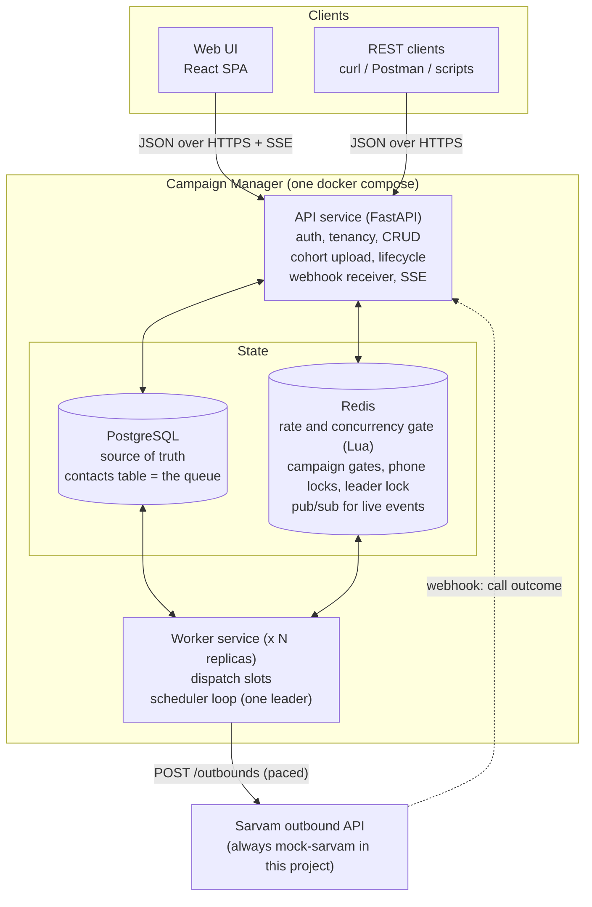
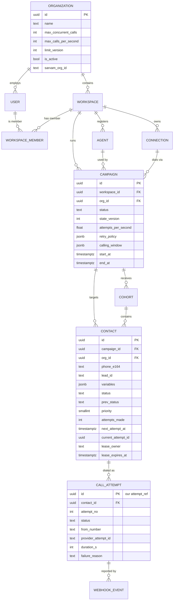
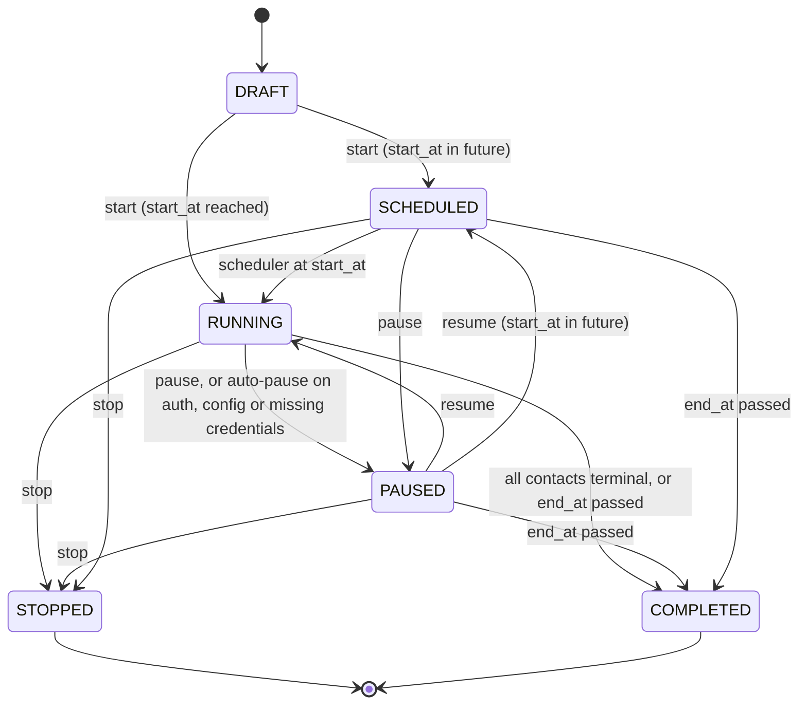
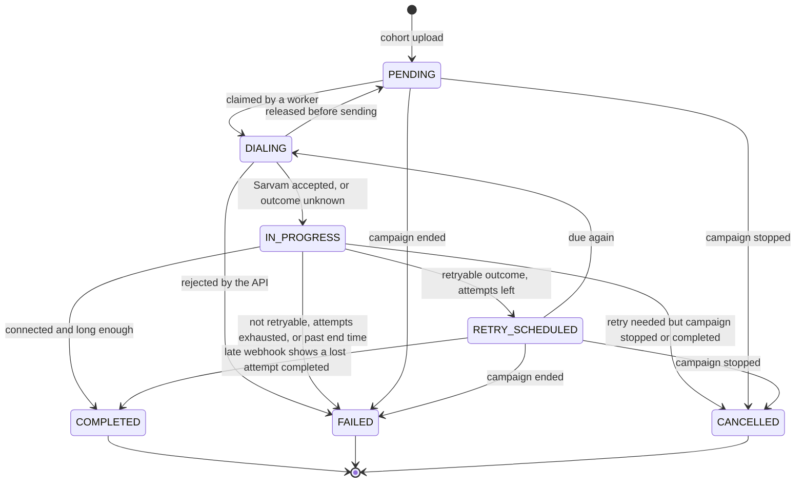
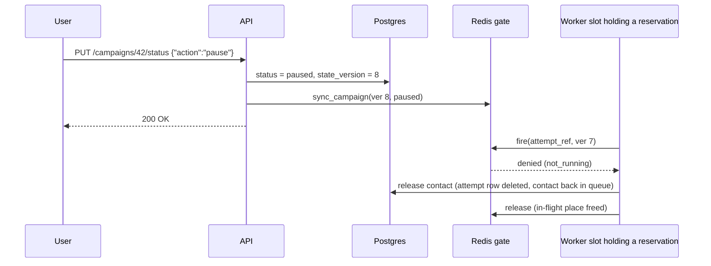
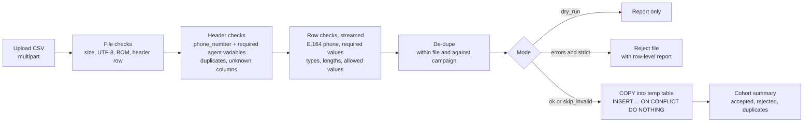

# 2. Architecture

> Part A is the **high-level design** (what the boxes are and how a call flows through them). Part B is the **low-level design** (tables, state machines, algorithms, scripts, failure handling). The "why this tech" comparison lives in `03-tech-stack-decisions.md`.

---

## 0. Seven design principles

The rest of the document follows from these. Most later sections trace back to one of them.

| # | Principle | What it buys us |
| --- | --- | --- |
| **P1** | **Postgres is the single source of truth. Redis holds only fast coordination state that can be rebuilt from Postgres.** | Losing Redis never loses business data; there is one place to look for "what is true". |
| **P2** | **Nothing is pre-queued. Each call is decided at the last possible moment** ("just-in-time dispatch"). Contacts stay rows in Postgres until a worker is about to dial them. | Pause, stop, window close and limit changes take effect immediately. There is no backlog that keeps calling people after a pause. |
| **P3** | **Every external call passes one atomic gate**: a Redis Lua script that checks campaign state, calling window, campaign pace, org pace and org concurrency together, using **Redis's clock**. | Both org limits hold no matter how many workers or machines exist. No clock-skew bugs. |
| **P4** | **At most once per attempt.** We would rather lose an attempt than call a customer twice. Uncertainty is resolved by webhook or timeout, **never by blind re-sends**. | A clear, defensible answer to "can a customer be called twice?" |
| **P5** | **Every state change is a compare-and-set** (`UPDATE ... WHERE status = <expected>`). Duplicate or late events become no-ops. | Races resolve deterministically; webhooks and retries are idempotent. |
| **P6** | **Background loops are level-triggered and idempotent.** Every second, compare desired vs actual state and fix the difference. | A missed event or crashed process is healed on the next tick. Running two loops by accident is harmless. |
| **P7** | **Correctness never depends on a lock or a leader.** Locks only save work. | Lock expiry, split brain or GC pauses can cost efficiency, never correctness. |

---

# Part A: High-Level Design

## A.1 System context and components



| Component | Responsibility | How it scales | State it holds |
| --- | --- | --- | --- |
| **Web UI** | Every screen: orgs, workspaces, agents, campaigns, uploads, live dashboards. Only talks to the public API. | Static files (nginx/CDN) | None |
| **API service** | AuthN/AuthZ, tenant scoping, validation, CRUD, cohort ingestion, lifecycle actions, webhook intake, SSE streams, OpenAPI docs | Stateless replicas behind a load balancer | None (all in PG/Redis) |
| **Worker: dispatch slots** | Pick runnable campaign → reserve slot → claim contact → fire → call Sarvam → record result | Replicas × async slots per replica | None (leases live in PG) |
| **Worker: scheduler loop** | Sync org limits, start scheduled campaigns, open/close windows, keep gates in sync, finish campaigns, reap stuck work, re-run stalled webhooks | One active leader (Redis lock), the rest hot standby | None |
| **PostgreSQL** | Tenants, users, agents, campaigns, contacts (the queue), attempts, webhook events | Vertical → partitioning → sharding by org | **Durable truth** |
| **Redis** | Atomic gate for both org limits (pacing state plus an in-flight set of reserved and live calls), campaign gates (state, window, pace), send-intent markers, phone locks, leader lock, pub/sub | One primary (+ replica); cluster-ready (keys hash-tagged per org) | **Ephemeral, rebuildable** |
| **mock-sarvam** *(the only Sarvam this project ever calls)* | Same contract as Sarvam. Simulates outcomes, sends webhooks, injects faults (503s, dropped and duplicate webhooks, set by env vars or `PATCH /config` at runtime), and **independently measures, per org, the max calls in any rolling second and the max calls live at once** (`GET /stats`) | n/a | In-memory |

**Why only two process types (API + worker)?** This is a **modular monolith**: one codebase and one domain model, split into processes only where the runtime profile differs. Request/response work stays in the API; long-running loops go in the worker. Microservices would add network hops, distributed transactions and deployment overhead with no benefit at this scale (see `03` → D1).

## A.2 The life of one call (end to end)

1. **Create.** A user creates a campaign (`DRAFT`) and uploads a cohort. Each CSV row becomes a `contacts` row with status `pending`.
2. **Start.** The user presses Start. The campaign becomes `RUNNING` (or `SCHEDULED` until its start time). The API writes Postgres first, then the campaign's **gate** in Redis (`state=running`, version, pace, window end).
3. **Window opens.** Every second the scheduler computes "are we inside the calling window, and until when?" It writes `window_until` into the gate and lists the campaign as *runnable*.
4. **Reserve.** A worker slot picks the campaign (round-robin) and asks the gate for a **send slot**. The gate grants one only if the org has a free place under its concurrent-call limit (the place is then held in the org's in-flight set) and the next evenly spaced send time is less than a second away. The reply is *"granted: send at +140 ms"* or *"denied: try in 300 ms"*.
5. **Claim.** The slot locks the next due contact in Postgres (`FOR UPDATE SKIP LOCKED`, so workers never block or collide) and creates **attempt #k** in the same transaction. It builds the request body now, before waiting.
6. **Fire.** The slot sleeps until its slot time, then runs the **fire check**. In one atomic step this asks: still running? window still open? on time? limits unchanged? phone not busy in another campaign? If all pass, it writes a **send-intent marker** and the reservation becomes a live call.
7. **Call Sarvam.** The slot POSTs to Sarvam with `metadata = {lead_id, attempt_ref, sig}`, stores Sarvam's `attempt_id`, and marks the contact `in_progress`.
8. **Outcome.** Sarvam calls the customer. When the call ends it POSTs our webhook. The API verifies the signature, stores the event, de-duplicates, and in one transaction updates the attempt and the contact: `completed`, `retry_scheduled` (next time shifted into the window) or `failed`. Then it frees the call's place in the in-flight set and its phone lock.
9. **Live.** An event goes out on Redis pub/sub. Every API instance with a browser watching that campaign pushes it over SSE, so the dashboard updates within a second.
10. **Finish.** When every contact is terminal (or the end time passes), the scheduler marks the campaign `COMPLETED`.

## A.3 How the design meets the non-functional goals

| Goal | Mechanism |
| --- | --- |
| **High concurrency** | Stateless API replicas. Workers run many async slots each (`DISPATCH_SLOTS`, 32 by default) and scale with `--scale worker=N`. `SKIP LOCKED` lets any number of workers dequeue without blocking each other. Gate decisions are O(1) in Redis (plus a small sorted-set trim for the in-flight set). |
| **Low latency** | A dispatch decision is one Redis round-trip (~sub-ms) plus one indexed Postgres transaction (~ms). Slots are **reserved**, not polled, so there is no thundering herd. UI updates are pushed (SSE), not polled. A webhook is stored with one insert and applied in one short transaction before we answer; if applying fails, the stored event is retried later. |
| **Accuracy (limits)** | One atomic gate, one clock (Redis `TIME`), an in-flight set for the concurrent-call cap, evenly spaced slots, a safety margin for jitter, and a late-fire cutoff. Proven by an independent referee in mock-sarvam (`make prove`, §B.19). |
| **Accuracy (state)** | Postgres transactions, compare-and-set transitions, unique constraints (`contact_id, attempt_no`), idempotent webhooks, versioned gate writes, and reconcile loops. |
| **Availability** | Any process can die at any instant. Leases plus reapers recover work, a standby takes over the scheduler, and Redis loss fails *closed* and rebuilds itself. |
| **Fairness** | Round-robin across campaigns at the slot level. Each org is paced independently, so one org's huge campaign can't consume another org's budget. A campaign that is pacing itself never blocks its siblings (§B.5). |
| **Isolation** | Every query is tenant-scoped (org → workspace). IDs from another org return 404. Secrets are encrypted per workspace. |

### Capacity estimate (design target, not the demo size)

| Quantity | Estimate | Headroom |
| --- | --- | --- |
| Peak dial rate | 1,000 dials/s across all orgs | Sarvam's own campaign max is 500/s per campaign |
| Postgres writes per dial | ≈4 (claim txn, dispatch record, webhook insert, webhook apply) → ~4,000/s | Well within one tuned Postgres node (order of 10k simple writes/s) |
| Redis operations per dial | ≈3 script calls + 1 publish → ~4,000/s | Redis handles 100k+ simple ops/s on one core |
| In-flight senders (Little's law: concurrency = rate × latency) | 1,000/s × (≤1 s slot wait + ~0.5 s API latency) ≈ 1,500 | 3 workers × 500 async slots |
| Webhooks | ~1,000/s | 2 to 4 API replicas |
| Storage | ~1 KB/contact + ~0.5 KB/attempt incl. indexes → 1M contacts ≈ 1.5 to 2 GB | Trivial |

The real ceiling is **Sarvam's rate limit, not our CPU**. That is why language speed was not the deciding factor in `03`.

---

# Part B: Low-Level Design

## B.1 Code layout

```
backend/
  app/
    main.py              # FastAPI app factory: routers, middleware, error handlers
    worker.py            # worker entrypoint: heartbeat + scheduler loop + N dispatch slots
    seed.py              # superadmin and demo data (run by the migrate service)
    healthcheck.py       # container healthchecks for api and worker
    core/                # config, db engine, redis, security (JWT, argon2, AES-GCM, HMAC), logging, errors, ids
    domain/              # PURE logic, no I/O, heavily unit-tested:
      states.py          #   statuses, lifecycle actions and which states each action may start from
      windows.py         #   calling-window maths (tz, DST, next_allowed, window_end)
      retry_policy.py    #   outcome → (retry? when?) decisions
      outcomes.py        #   Sarvam webhook → our outcome classification
      cohort_schema.py   #   agent variables → CSV validators, sample CSV, error report
    models/              # SQLAlchemy tables
    schemas/             # Pydantic request/response models (these generate the OpenAPI spec)
    services/            # use cases: lifecycle, cohorts, outcomes (webhooks), scope (tenant-checked loading)
    api/                 # deps (session, tenant context), health, request-id middleware
      v1/                # thin routers: parse → call service → respond
    engine/
      gate.py            # Python wrapper around the Lua scripts, plus the Redis key names
      lua/               # reserve, fire, refund, release, cooldown, sync_campaign, sync_org
      dispatcher.py      # the slot loop and error handling per result class
      scheduler.py       # leader election + reconcile tick (includes the reapers and the webhook sweeper)
      repo.py            # hot-path SQL: claim, release, record_dispatch, apply_outcome
      sarvam_client.py   # payload builder + HTTP + error classification
      events.py          # publish after commit (pub/sub)
    tools/
      prove_limits.py    # `make prove`: load test on the real stack, refereed by the mock
      export_api.py      # `make api-docs`: docs/api/openapi.json + Postman collection
  migrations/            # Alembic
  tests/                 # unit/ (no database) and integration/ (real Postgres + Redis)
mock_sarvam/             # contract-compatible fake + referee for both limits
frontend/                # React + Vite + TypeScript
docs/api/                # generated OpenAPI spec and Postman collection
docker-compose.yml
```

**Rule of thumb:** `domain/` knows nothing about HTTP, SQL or Redis, so the hardest logic (windows, retries, transitions) is tested with plain unit tests. Routers are thin, so the UI and REST clients go through exactly the same code path (requirement F7).

## B.2 Data model



### Tables (key columns only)

| Table | Purpose | Notable columns |
| --- | --- | --- |
| `organizations` | Tenant | `max_concurrent_calls`, `max_calls_per_second`, `limit_version` (bumped when either limit or `is_active` changes), `sarvam_org_id`, `is_active` |
| `workspaces` | Team space | `org_id`, `sarvam_workspace_id`, `sarvam_api_key_enc` (AES-GCM), `sarvam_api_key_last4` |
| `users` | Login identity | `email` (unique), `password_hash` (argon2id), `role` (superadmin / org_admin / member), `org_id` (null for superadmin), `is_active` |
| `workspace_members` | Member → workspace access | PK (`user_id`, `workspace_id`) |
| `agents` | Registered Sarvam agent | `app_id`, `app_version`, `variables` JSONB: `[{name, type, required, example, max_length, allowed}]`, `initial_bot_message`, `initial_state_name` |
| `connections` | Telephony connection | `connection_id`, `caller_numbers text[]` |
| `campaigns` | The job definition | `status`, `state_version`, `attempts_per_second`, `caller_numbers text[]`, `retry_policy` JSONB, `calling_window` JSONB `{timezone, days[], start, end}`, `start_at`, `end_at`, `app_overrides`, `pause_reason`, `started_at`, `finished_at` |
| `cohorts` | One upload | `filename`, `rows_total`, `rows_accepted`, `rows_rejected`, `rows_duplicate`, `error_report` |
| `contacts` | **The unit of work and the queue** | `cohort_id`, `status`, `prev_status`, `priority` (0 = due retry, 1 = fresh), `next_attempt_at`, `attempts_made`, `current_attempt_id`, `lease_owner`, `lease_expires_at`, `last_outcome`, `final_reason` |
| `call_attempts` | One dial | `id` (= `attempt_ref` we send in metadata), `attempt_no`, `status`, `from_number`, `provider_attempt_id`, `created_at`, `dispatched_at`, `ended_at`, `duration_s`, `failure_reason`, `http_status` |
| `webhook_events` | Raw inbound webhooks (audit + idempotency) | `dedupe_key` (unique, sha256), `attempt_ref`, `payload` JSONB, `received_at`, `processed_at`, `error` |

### Constraints and indexes that carry correctness or speed

```sql
-- One phone number once per campaign (de-dupe at upload time, enforced by the DB)
ALTER TABLE contacts ADD CONSTRAINT uq_contacts_campaign_id_phone_e164 UNIQUE (campaign_id, phone_e164);

-- An attempt number can exist only once per contact: the last line of defence against double dispatch
ALTER TABLE call_attempts ADD CONSTRAINT uq_call_attempts_contact_id_attempt_no UNIQUE (contact_id, attempt_no);

-- THE QUEUE INDEX: small, partial, ordered exactly like the claim query
CREATE INDEX ix_contacts_due ON contacts (campaign_id, priority, next_attempt_at, id)
  WHERE status IN ('pending', 'retry_scheduled');

-- Live counters and filtered contact lists
CREATE INDEX ix_contacts_campaign_status ON contacts (campaign_id, status);

-- Reaper scans
CREATE INDEX ix_contacts_lease ON contacts (lease_expires_at) WHERE status = 'dialing';
CREATE INDEX ix_call_attempts_open ON call_attempts (created_at)
  WHERE status IN ('reserved', 'dispatched', 'unknown');

-- Webhook idempotency
ALTER TABLE webhook_events ADD CONSTRAINT uq_webhook_events_dedupe_key UNIQUE (dedupe_key);
```

**IDs:** UUIDv7 (time-ordered) for every public id. They insert in order, which keeps B-tree indexes compact, and they aren't guessable, so ids can't be enumerated across tenants. `org_id` is denormalised onto campaigns, contacts and attempts so tenant filters and per-org gate keys never need a join.

## B.3 State machines

### Campaign



- `domain/states.py` lists, for each action, the states it may start from (`ACTION_ALLOWED_FROM`) and the states where it has already happened (`ACTION_ALREADY_DONE`). Repeating an action that already happened returns 200 and changes nothing. Any other move is a 409.
- The transition itself is one compare-and-set update that also bumps `state_version`:
  `UPDATE campaigns SET status = :to, state_version = state_version + 1 WHERE id = :id AND status = :status_we_read RETURNING state_version`.
  Zero rows means someone else changed the campaign at the same moment, so the caller gets a 409 and reloads.
- `start` needs at least one contact and an `end_at` that hasn't passed (422 otherwise). A user `pause` records `pause_reason = user`.
- `RUNNING` + outside the window is shown in the UI as **"Waiting for window (opens Mon 09:00 IST)"**. It is *derived*, not stored (`GET /campaigns/{id}/stats` returns `in_window`, `window_closes_at` and `next_window_opens_at`), so there is no extra state to keep consistent.
- Starting or resuming a campaign whose `start_at` is still in the future puts it in `SCHEDULED`.
- Editable only while `DRAFT`, `SCHEDULED` or `PAUSED`: name, pace, retry rules, window, start and end time, caller numbers, app overrides. Agent and connection can't be changed after creation, because the cohorts were validated against that agent's variables. Only a `DRAFT` campaign can be deleted.

### Contact



"Released before sending" restores `prev_status` (`pending` or `retry_scheduled`) and keeps `next_attempt_at`, so the contact loses nothing. The UI maps `DIALING` and `IN_PROGRESS` to **in progress** and `RETRY_SCHEDULED` to **retrying**. **Attempts made** is `attempts_made`.

### Attempt

| Status | Meaning | Terminal? |
| --- | --- | --- |
| `reserved` | Row created at claim time; not yet sent. If released, the row is **deleted** (it never happened) | no |
| `dispatched` | Sarvam answered 2xx and gave us its `attempt_id` | no |
| `unknown` | Request may have been sent but we have no definitive answer (read timeout, dropped connection, a 5xx other than 503, worker died after the send marker) | no |
| `completed` / `busy` / `no_answer` / `short_call` / `failed` | Outcome from the webhook | yes |
| `rejected` | Sarvam answered a 4xx other than 401, 403 or 429; the call wasn't placed and is never retried | yes |
| `lost` | Sent (or maybe sent), no webhook within `WEBHOOK_TIMEOUT_S` (15 min by default, 5 min in the compose file) | yes |

## B.4 The dispatch pipeline (worker slot loop)

Each worker process runs `DISPATCH_SLOTS` (default 32) copies of this loop. One iteration:

```python
async def dispatch_one(worker):
    campaign = worker.pick()                               # local round-robin over the runnable map, skipping cooled-down campaigns
    if campaign is None:
        await sleep(0.2)
        return

    attempt_ref = new_id()                                 # our id for this attempt, made before anything else
    grant = await gate.reserve(org, campaign, attempt_ref) # (1) Lua: state, window, org concurrency, campaign pace, org pace
    if not grant.ok:
        worker.cool_down(campaign, grant.retry_after_ms)
        return

    from_number = caller_numbers[(grant.rr - 1) % len(caller_numbers)]   # round-robin counter from the gate
    claim = await repo.claim_next(campaign, grant.campaign_ver, attempt_ref, from_number)  # (2) one txn, SKIP LOCKED
    if claim is None:                                      # nothing due right now
        await gate.refund(grant)                           # give back the slot and the in-flight place
        worker.cool_down(campaign, 500)
        return

    payload = build_payload(campaign, claim, attempt_ref)  # (3) built now, so nothing slow sits between the check and the send
    await sleep_ms(grant.delay_ms)                         # (4) wait for our exact slot (at most ~1 s)

    verdict = await gate.fire(grant, claim)                # (5) Lua: last check + send-intent marker
    while verdict.reason == "early":                       #     woke a hair too soon: wait the remainder
        await sleep_ms(verdict.wait_ms)
        verdict = await gate.fire(grant, claim)
    if not verdict.ok:                                     # paused / stopped / window closed / late / limits changed / phone busy / revoked
        await repo.release(claim, defer=300 if verdict.reason == "phone_busy" else 0)  # back to the queue (compare-and-set)
        await gate.release(org, attempt_ref, claim.phone)  # free the in-flight place and the phone lock
        return

    result = await sarvam.place_call(payload)              # (6) the only external call
    await handle_result(claim, result)                     # (7) record, release or pause, by error class (§B.16)
```

Why this order?

- **Reserve before claim:** we only lock a contact when we already have a slot (and a concurrency place) for it, so contacts aren't held hostage while a busy org waits for capacity.
- **Claim and build before sleep:** the database work and the request body are done *before* the slot time. Between "slot reached" and "bytes on the wire" there is only one Redis call, which keeps send-time jitter tiny. Building the payload before the wait was added after the real-stack load test described in §B.5.
- **Fire check at the last moment:** this is what makes pause, stop and window close exact (§B.10).

## B.5 The gate: how the org limits are guaranteed

Each org has two limits (see `01` A1): **`max_concurrent_calls`**, how many calls may run at the same time, and **`max_calls_per_second`**, how many calls may reach Sarvam in any rolling second. Both are enforced by the same Lua script, in the same atomic step. The pacing half is explained first, then the concurrency half.

### Why the obvious approaches fail

| Approach | What goes wrong |
| --- | --- |
| Limiter inside each worker | 3 workers × "5/s" = 15/s. Budgets add up. |
| Fixed window counter ("5 per calendar second") | 5 calls at 0.99 s + 5 at 1.01 s = **10 calls within 20 ms**. |
| Token bucket with burst = N | Full bucket (5) plus refill during the same second ⇒ up to ~2N in a rolling second. |
| Rely on Sarvam's 429s | Every rejected request **is still a hit**, so the requirement is already broken. |
| Sliding-window log | Exact, but grants arrive in bursts (5 at once). Polling clients cause a thundering herd. |
| **GCRA (evenly spaced slots) + reservations** ✅ | Exact, O(1) memory, smooth pacing that any downstream limiter accepts, no polling. |

### The idea in plain words

A ticket counter. For an org with limit N, the counter hands out **send times spaced T = 1000/N ms apart** (5/s → one every 200 ms; the safety margin below stretches this a little). A worker asks for a ticket and is told *"your slot is at 12:00:00.400"*. It sleeps until then and sends. The counter (Redis) is shared by every worker on every machine, and it hands out tickets atomically, so two workers can never get the same slot.

**Proof that it holds:** consecutive grants are at least T apart, so any half-open 1-second interval `[t, t+1000)` can contain at most `1000 / T = N` grants. ∎

### Jitter: making the guarantee hold at Sarvam's door, not just ours

A send can happen slightly *after* its slot (event-loop lag; the fire check rejects anything more than `L` ms late), and network delay varies by up to `J` ms. If two sends move closer together than T, Sarvam could see N+1 calls in a rolling second. So we pace with a **safety margin M ≥ L + J**:

```
T = ceil((1000 + M) / N)      -- M = RATE_MARGIN_MS (default 100), L = LATE_TOLERANCE_MS (default 20)
```

For any N+1 consecutive arrivals, `span ≥ N·T − L − J ≥ 1000 + M − M = 1000 ms`, so **no rolling second ever contains more than N calls**. The cost is about M/1000 of throughput: with M = 100 we use about 91% of the limit (at 5/s, one call every 220 ms). That trade is explicit and configurable: with `M = 0` you get exactness at our side only.

**Why 100 ms and not 50.** The first version used M = 50. A load test on the real stack (API, worker, Redis, Postgres and the mock, all in Docker) found one second in which the mock counted 6 calls at a limit of 5. With L = 20, a 50 ms margin only covers 30 ms of network jitter between our send and the mock's count, and the real jitter was larger. We raised M to 100 ms and moved building the request payload to before the wait, so the only work between the final check and the send is the HTTP write. Every proof run since then has held at the limit (§B.19).

### The concurrent-call limit

Each org has an **in-flight set**, `{o:<org>}:inflight`: a Redis sorted set of `attempt_ref`s, each scored with an expiry time in ms. It holds every call that is reserved or live.

- **`reserve.lua`** first drops expired members, then denies with `org_busy` (try again in 250 ms) if the set already holds `max_concurrent_calls` members. Otherwise it adds the new `attempt_ref`, expiring about 11 s after its slot (the 1 s horizon plus 10 s), so a reservation that is never fired or refunded frees itself.
- **`fire.lua`** checks the reservation is still in the set (`reservation_lost` if it expired) and then re-scores it to `now + WEBHOOK_TIMEOUT_S`: the reservation is now a live call.
- **`release.lua`** removes it when the call is over: when the outcome is processed (webhook, rejected request or the lost timeout), and also when the call was never placed (fire denied, 503, 429, auth error, connection failure, or the reaper freeing an unsent lease). `refund.lua` removes it when no contact was due.

Why count reservations and not only live calls? If only live calls counted, several workers could each see "below the cap" at the same time, all reserve, and all fire. Counting the place at reserve time makes the check and the booking one atomic step. Why expiries and not a counter? A counter leaks a place every time a worker dies at the wrong moment; an expiring member frees itself. The count is deliberately conservative: a call holds its place from its reservation until its webhook is processed, which is slightly longer than the call lasts at Sarvam, so our count is never lower than Sarvam's.

### Three checks in one atomic step

Each dial must satisfy the campaign's own pace (APS), the org's pace **and** the org's concurrent-call cap. All three are checked and updated in the same Lua script, so they can never disagree. One rule prevents head-of-line blocking: if the *campaign* isn't ready at the org's next free slot, we **deny without touching the org schedule**. Another campaign can then take that slot, so a slow campaign never wastes its org's budget.

### `reserve.lua` (outline)

```lua
-- KEYS[1] = {o:<org>}:gate        hash: cps, max_concurrent, tat, cooldown_until, limit_ver
-- KEYS[2] = {o:<org>}:c:<camp>    hash: state, ver, window_until, aps, tat, rr
-- KEYS[3] = {o:<org>}:inflight    zset: attempt_ref -> expiry ms (reserved + live calls)
-- ARGV[1] = horizon_ms (1000)  ARGV[2] = margin_ms (100)  ARGV[3] = attempt_ref  ARGV[4] = reserve_ttl_ms (11000)
local t   = redis.call('TIME')                                    -- ONE clock for every worker
local now = tonumber(t[1]) * 1000 + math.floor(tonumber(t[2]) / 1000)

local c = redis.call('HMGET', KEYS[2], 'state', 'window_until', 'aps', 'tat', 'ver')
if c[1] ~= 'running' then return {0, 'not_running', 1000} end
local window_until = tonumber(c[2]) or 0
if now >= window_until then return {0, 'window_closed', 1000} end

local o = redis.call('HMGET', KEYS[1], 'cps', 'max_concurrent', 'tat', 'cooldown_until', 'limit_ver')
local cps, max_concurrent = tonumber(o[1]) or 0, tonumber(o[2]) or 0
if cps <= 0 or max_concurrent <= 0 then return {0, 'org_disabled', 1000} end   -- missing key => fail closed

-- concurrency: calls reserved or live right now (expired entries dropped first)
redis.call('ZREMRANGEBYSCORE', KEYS[3], '-inf', now)
if redis.call('ZCARD', KEYS[3]) >= max_concurrent then return {0, 'org_busy', 250} end

-- pacing (GCRA)
local margin = tonumber(ARGV[2])
local t_org  = math.ceil((1000 + margin) / cps)
local t_camp = math.ceil((1000 + margin) / (tonumber(c[3]) or 1))

local slot  = math.max(now, tonumber(o[3]) or 0, tonumber(o[4]) or 0)  -- next free org slot (after any cooldown)
local ready = math.max(now, tonumber(c[4]) or 0)                       -- campaign's own pace
if ready > slot then return {0, 'campaign_pace', ready - now} end      -- don't block the org
if slot - now > tonumber(ARGV[1]) then return {0, 'org_pace', slot - now - tonumber(ARGV[1])} end
if slot >= window_until then return {0, 'window_closed', 1000} end

redis.call('HSET', KEYS[1], 'tat', slot + t_org)                       -- book the org slot
redis.call('HSET', KEYS[2], 'tat', slot + t_camp)                      -- and the campaign slot
local rr = redis.call('HINCRBY', KEYS[2], 'rr', 1)                     -- caller-number round-robin
redis.call('ZADD', KEYS[3], slot + tonumber(ARGV[4]), ARGV[3])         -- hold a concurrency place
return {1, slot, slot - now, c[5], o[5], rr}
```

- **Horizon (1 s):** a slot can be booked at most 1 s ahead. That bounds outstanding reservations (≈ N per org) and how long a pause has to "catch" sleepers.
- **Refund (`refund.lua`):** if the claim found no contact, we give the slot back, but only if nobody booked after us (`tat == slot + T`). Otherwise it is a harmless gap. The concurrency place is always given back.
- **Cooldown (`cooldown.lua`):** pushes `cooldown_until`, and with it the org's next slot, into the future (a circuit breaker): 2 s after a 503 or a connection failure, the `Retry-After` value (else 1 s) after a 429, and 30 s after five `unknown` results in a row.

### `fire.lua` (the last-moment check)

```lua
-- KEYS: campaign gate, org gate, in-flight zset, phone lock {o:<org>}:ph:<phone>,
--       send marker {o:<org>}:sent:<attempt_ref>, fires zset {o:<org>}:fires
-- ARGV: slot_ms, late_tolerance_ms, attempt_ref, campaign_ver, limit_ver, phone_lock_ttl_s, call_ttl_ms
now = TIME
if campaign.state ~= 'running' or campaign.ver ~= ARGV.campaign_ver   -> deny 'not_running'      (pause/stop since reserve)
if now >= campaign.window_until                                       -> deny 'window_closed'
if now <  slot                                                        -> deny 'early'            (sleep the remainder, retry)
if now >  slot + late_tolerance                                       -> deny 'late'             (never send late)
if org.limit_ver ~= ARGV.limit_ver                                    -> deny 'limit_changed'    (re-reserve under the new limits)
if attempt_ref not in the in-flight set                               -> deny 'reservation_lost' (its place expired)
if phone lock held by another attempt                                 -> deny 'phone_busy'       (another campaign is calling them)
if SET send marker = 'sent' NX EX 86400 fails                         -> deny 'revoked'          (the reaper already took this attempt back)
SET phone lock = attempt_ref EX phone_lock_ttl
ZADD in-flight attempt_ref (now + call_ttl)                           -- the reservation becomes a live call
ZADD fires attempt_ref now                                            -- feeds the live rate chart
return ok
```

The send marker is written with **`SET ... NX`** (only if absent). The reaper uses the same key, writing `revoked` with `NX` before it re-queues a stuck contact (§B.9). Whoever writes the key first wins, so a worker that froze past its lease can never send an attempt the reaper has already handed back. This is a *fencing* check, so correctness doesn't depend on lease timing (P7).

All keys of one org share the hash tag `{o:<org>}`, so every script touches a single Redis Cluster slot and stays cluster-safe.

## B.6 Claiming a contact (Postgres as a queue)

```sql
BEGIN;
-- 1) + 2) pick the next due contact that no other worker holds (others skip it instead of waiting)
--         and mark it as being dialed, with a lease the reaper can check
WITH picked AS (
    SELECT c.id FROM contacts c
    WHERE c.campaign_id = $1
      AND c.status IN ('pending', 'retry_scheduled')
      AND c.next_attempt_at <= now()
      AND EXISTS (SELECT 1 FROM campaigns k        -- Postgres must agree the campaign is running,
                  WHERE k.id = $1                  -- at the same version the gate granted under
                    AND k.status = 'running'
                    AND k.state_version = $granted_version)
    ORDER BY c.priority, c.next_attempt_at, c.id   -- due retries first, then oldest
    LIMIT 1
    FOR UPDATE OF c SKIP LOCKED
)
UPDATE contacts c
SET status = 'dialing', prev_status = c.status, attempts_made = c.attempts_made + 1,
    current_attempt_id = $attempt_ref, lease_owner = $worker_id,
    lease_expires_at = now() + interval '60 seconds', updated_at = now()   -- LEASE_SECONDS
FROM picked WHERE c.id = picked.id
RETURNING c.id, c.org_id, c.campaign_id, c.phone_e164, c.lead_id, c.variables, c.attempts_made;

-- 3) reserve the attempt row (UNIQUE (contact_id, attempt_no) is the backstop)
INSERT INTO call_attempts (id, org_id, campaign_id, contact_id, attempt_no, status, from_number, created_at)
VALUES ($attempt_ref, $org_id, $1, $contact_id, $attempts_made, 'reserved', $from_number, now());
COMMIT;
```

- **`SKIP LOCKED`** is the key to concurrency. Ten workers asking at once get ten *different* contacts instead of queueing behind one row lock.
- The partial index `ix_contacts_due` matches the `WHERE` + `ORDER BY` exactly, so this is an index range scan that stops at the first unlocked row.
- **Campaign guard (`EXISTS ...`):** a claim only succeeds if Postgres agrees the campaign is `running` at the exact version the gate granted under. This is the database half of pause/stop safety (§B.10). It costs one primary-key lookup.
- **Why due retries first (`priority`)?** If fresh contacts always came first, a 30-minute "no answer" retry in a 2-hour campaign would really happen after 2 hours. Retries are time-sensitive and bounded by max attempts, so they can't starve fresh contacts.
- **Lock order rule:** code that touches both rows always locks **attempt → contact** (webhook handler, recorder, reaper), so these paths can't deadlock.

**`release`** (never sent): delete the `reserved` attempt row (guard: `status = 'reserved'`; if it is gone, nothing else happens) and restore `prev_status`, `attempts_made - 1`, and clear the lease. Guard: `WHERE status = 'dialing' AND current_attempt_id = $attempt_ref`. For `phone_busy` we also push `next_attempt_at` 5 minutes out. The caller then runs `release.lua` to free the in-flight place.

**`record_dispatch`** (after HTTP) is all compare-and-set, because the webhook can beat us here:

```sql
UPDATE call_attempts SET status = $status,       -- 'dispatched', or 'unknown' if we can't tell
       provider_attempt_id = $pid, http_status = $http, dispatched_at = now(), failure_reason = $error
 WHERE id = $attempt_ref AND status IN ('reserved', 'unknown');        -- no-op if webhook already finalised it
UPDATE contacts SET status = 'in_progress', lease_owner = NULL, lease_expires_at = NULL
 WHERE id = $contact_id AND status = 'dialing' AND current_attempt_id = $attempt_ref;
```

## B.7 Calling windows (time maths)

Stored per campaign: `calling_window = {timezone: "Asia/Kolkata", days: [1..7 ISO], start: "09:00", end: "18:00"}`, plus `start_at` / `end_at` (UTC instants). The API default is Asia/Kolkata, Monday to Saturday, 09:00 to 21:00. `start` must be before `end` (no overnight windows), and `start_at` / `end_at` must carry a timezone.

Two pure functions in `domain/windows.py` do all the work:

```python
def window_end(now_utc, cw, start_at, end_at) -> datetime | None:
    """If `now` is inside an allowed window (and between start_at and end_at), return when that
    window closes, capped by end_at; else None."""

def next_allowed(t_utc, cw, start_at, end_at) -> datetime | None:
    """Earliest instant >= t that is inside an allowed window and before end_at; None if there is none."""
    # walk at most 8 local days forward: skip disallowed weekdays, clamp to [start, end) local time,
    # convert local -> UTC with zoneinfo (DST gaps and overlaps resolved by the tz database)
```

- The **scheduler** uses `window_end` every second to write `window_until` (epoch ms) into the campaign gate (0 when the campaign isn't running or is outside its window). The gate compares it with Redis time, so **windows close with millisecond precision**, not "at the next tick".
- **Retries** use `next_allowed(now + delay)`. A retry computed for 19:30 in a 09:00 to 18:00 window lands at 09:00 on the next allowed day. A `None` result means "past the end time", so the contact fails with `campaign_ended`.
- **Property tests** (Hypothesis) generate random instants (2026 to 2030), timezones (Asia/Kolkata, America/New_York, Europe/London, UTC), weekday sets and daily hours, and check two invariants: the result is ≥ t and inside a window, and nothing earlier is callable (so it is the earliest). Fixed tests cover the rest: `end_at` cutting a window short, skipping a weekend, `start_at` and `end_at` bounds, and DST (9 a.m. in New York is 13:00 UTC in July and 14:00 UTC in December).

## B.8 Webhooks, outcomes and retries

### Building the request (the only external call)

```json
{
  "app_config": {
    "app_id": "<agent.app_id>", "app_version": 7, "app_type": "agent",
    "connection_config": { "connection_id": "<connection_id>", "agent_phone_number": "<caller number, round-robin>" },
    "agent_variables": { "...": "values from the contact's CSV row" },
    "app_overrides": { "initial_bot_message": "...", "initial_state_name": "..." }
  },
  "user_config": { "user_phone_number": "<contact.phone_e164>" },
  "webhook_config": {
    "url": "<PUBLIC_BASE_URL>/api/v1/webhooks/sarvam",
    "metadata": { "lead_id": "<contact.lead_id>", "attempt_ref": "<call_attempts.id>", "sig": "<HMAC-SHA256(secret, attempt_ref)>" }
  }
}
```

It is sent as `POST {SARVAM_BASE_URL}/api/outbounds/v1/orgs/{sarvam_org_id}/workspaces/{sarvam_workspace_id}/outbounds` with the workspace's key in `X-API-Key`. `SARVAM_BASE_URL` always points at mock-sarvam: the assignment allows only mock calls. `app_overrides` is sent only when the agent or campaign sets one.

`attempt_ref` is generated **by us, before sending**, so a webhook can be matched to its attempt even if the worker died before saving Sarvam's response. `sig` is an HMAC-SHA256 of `attempt_ref` with `WEBHOOK_SIGNING_SECRET`. Sarvam echoes `metadata` back in the webhook, so `sig` authenticates it; Sarvam doesn't document webhook signing.

### Classifying the outcome

| Sarvam `status` | `duration` | Our outcome | Default retry rule |
| --- | --- | --- | --- |
| `connected` | ≥ short-call threshold | `completed` | none, the contact is done |
| `connected` | < threshold | `short_call` | retry after delay |
| `busy` | n/a | `busy` | retry after delay |
| `no_answer` | n/a | `no_answer` | retry after delay |
| `failed` | n/a | `failed` | configurable (default off: often NDNC or invalid number) |
| *(no webhook within `WEBHOOK_TIMEOUT_S`)* | n/a | `lost` | follows the `failed` rule |

A request Sarvam refuses with a 4xx (`rejected`, §B.16) never reaches this table: the contact fails at once and is never retried.

### Webhook handler

```
POST /api/v1/webhooks/sarvam
 1. Parse leniently; read attempt_ref and sig from webhook_config.metadata; verify the HMAC
    (missing or bad sig → 401, attempt_ref not a UUID → 422).
 2. INSERT INTO webhook_events (dedupe_key = sha256(attempt_ref|status|duration|attempt_id), payload)
    ON CONFLICT DO NOTHING        → already seen? return 200 {"status": "duplicate"}.
    This insert commits on its own, so the event is safe even if the next step fails.
 3. One transaction:
      lock the event row (SKIP LOCKED, so the API and the sweeper never apply it at the same time)
      lock attempt FOR UPDATE      → already terminal? done (late duplicate).
                                     (exception: a `lost` attempt whose real result turns out to be `completed`
                                      while its retry is still waiting: the retry is dropped and the contact completed)
      attempt ← outcome, duration, failure_reason, provider_attempt_id
      lock contact FOR UPDATE      → moved on to a newer attempt? stop here
                                   → decide(outcome, attempts_made, policy, campaign) → completed | retry_scheduled | failed | cancelled
      UPDATE contact (priority 0 if it is a retry)
      webhook_events.processed_at = now()
 4. After commit: release.lua frees the call's in-flight place and its phone lock (the lock only if it still
    holds this attempt_ref), publish a live event, return 200.
    If step 3 throws, the error is saved on the event row, and the scheduler's sweeper retries every
    unprocessed event older than 30 s.
```

### The retry decision (`domain/retry_policy.py`)

```python
def decide(outcome, attempts_made, policy, campaign_status, window, start_at, end_at, now):
    if outcome == "completed":                      return Completed()
    if outcome == "rejected":                       return Failed(reason="rejected")   # won't succeed on a retry
    rule = policy.rules.get("failed" if outcome == "lost" else outcome)   # busy / no_answer / short_call / failed
    if rule is None or not rule.enabled:            return Failed(reason=outcome)
    if attempts_made >= policy.max_attempts:        return Failed(reason="max_attempts_reached")
    if campaign_status in ("stopped", "completed"): return Cancelled(reason=f"campaign_{campaign_status}")
    delay = rule.delay_s * (policy.backoff ** (attempts_made - 1))    # backoff = 1 means fixed delay
    when = next_allowed(now + delay, window, start_at, end_at)
    if when is None:                                return Failed(reason="campaign_ended")
    return RetryScheduled(next_attempt_at=when)     # the contact also gets priority 0
```

Retry policy shape, stored as JSONB on the campaign and validated by Pydantic (`max_attempts` 1 to 10, `backoff` 1.0 to 5.0, `short_call_threshold_s` 0 to 600, delays up to 7 days). These are also the defaults:

```json
{
  "max_attempts": 3,
  "short_call_threshold_s": 10,
  "backoff": 1.0,
  "rules": {
    "busy":       { "enabled": true,  "delay_s": 600 },
    "no_answer":  { "enabled": true,  "delay_s": 1800 },
    "short_call": { "enabled": true,  "delay_s": 3600 },
    "failed":     { "enabled": false, "delay_s": 900 }
  }
}
```

**Retries vs. limits:** a retry is the same contact row with a new `next_attempt_at`. It is claimed by the same query and passes through the **same gate**, so it counts against both org limits. No separate retry path exists that could bypass them.

## B.9 The scheduler (reconcile loop) and the reaper

Every worker runs the scheduler loop, but only the holder of the Redis lock `scheduler:leader` acts (`SET scheduler:leader <worker_id> NX PX 5000`; the holder extends it every tick). Each tick (`SCHEDULER_TICK_S`, 1 s), in this order:

| Step | What it does | Why it is safe to repeat |
| --- | --- | --- |
| 1. Sync orgs | Write `cps`, `max_concurrent` and `limit_ver` into every org gate with `sync_org.lua` (versioned by `limit_version`; an inactive org gets 0, so it fails closed). **Cold-start guard:** if an org gate was missing (Redis restarted), set `tat = now + 1000 ms`, so calls sent just before the restart are still accounted for | versioned, idempotent |
| 2. Activate | `SCHEDULED` campaigns with `start_at <= now` → `RUNNING` | conditional update |
| 3. Finish | `RUNNING`, `PAUSED` or `SCHEDULED` past `end_at` → `COMPLETED`; `RUNNING` with contacts but none open (`pending`, `dialing`, `in_progress`, `retry_scheduled`) → `COMPLETED` | conditional update |
| 4. Sync campaigns | For each `RUNNING`, `PAUSED` or `SCHEDULED` campaign: compute `window_until` and write the campaign gate with `sync_campaign.lua` (**versioned**, see §B.10). Then rewrite the `runnable` hash in one transaction: the `RUNNING` campaigns that are inside their window and have a contact due | stale writers are rejected by version |
| 5. Finalise | For `STOPPED` / `COMPLETED` campaigns, move remaining `pending` / `retry_scheduled` contacts to `cancelled(campaign_stopped)` / `failed(campaign_ended)` in **batches of 5,000** (`SKIP LOCKED`), so stopping a 1M-row campaign never holds one giant transaction | batched, conditional |
| 6. Reap leases | Up to 200 `dialing` contacts with expired leases: try `SET send marker = 'revoked' NX`. **Succeeded** ⇒ never sent, and now it never can be ⇒ `release` (free retry) and free its in-flight place. **Failed because the marker says `sent`** ⇒ maybe sent ⇒ attempt `unknown`, contact `in_progress`, wait for webhook | the marker decides atomically; nothing is ever re-sent |
| 7. Reap lost | Up to 200 attempts `dispatched` / `unknown` older than `WEBHOOK_TIMEOUT_S` → `lost`; free the in-flight place and the phone lock → retry policy (`lost` follows the `failed` rule) | conditional update |
| 8. Sweep webhooks | Re-process up to 100 `webhook_events` with `processed_at IS NULL` received more than 30 s ago | handler is idempotent |
| Every 30 ticks | Trim `{o:<org>}:fires` to the last 10 minutes | idempotent |

Workers refresh the **runnable map** every 500 ms and round-robin over it locally (each worker starts at a random offset). Gate denials put a campaign on a short local cool-down (20 ms to 2 s, from the gate's `retry_after_ms`), so slots don't hammer it.

## B.10 Lifecycle actions and the versioned gate

`PUT /api/v1/campaigns/{id}/status` with `{"action": "start" | "pause" | "resume" | "stop"}`. The flow is the same for every action:

1. **Postgres first:** conditional transition + `state_version + 1` (§B.3).
2. **Then Redis:** `sync_campaign.lua(ver, state, aps, window_until)`, which **refuses writes with an older version than the stored one**.
3. Publish `campaign.updated`, then respond.

Editing a campaign (`PATCH`) and changing an org's limits (`PATCH /organizations/{id}`, which bumps `limit_version`) also write their gate straight away instead of waiting for the next tick.

**Why the version matters.** Consider this race: the scheduler reads "running, v7" → a user pauses (DB v8, Redis v8 "paused") → the scheduler writes "running, v7" to Redis. Without versions, the campaign would silently un-pause. With versions, the stale v7 write is rejected. This is the classic *fencing token* pattern.



**Two independent guards.** A send needs Postgres to say "running, version v" at **claim** time (§B.6) **and** Redis to say "running, version v" at **fire** time. Even if Redis were briefly unavailable or stale during a pause, the database guard alone stops new claims.

**Guarantee:** once the pause/stop API has responded, no new request for that campaign leaves any worker. A send either passed `fire` *before* the gate flipped (it was already in flight) or it is denied. Calls already on the phone finish, and their webhooks are still processed. Retries computed during a pause are stored and become due after resume. The engine end-to-end test checks this directly: no call reaches the fake Sarvam after the pause is acknowledged.

**Auto-pause:** a 401/403 from Sarvam pauses every running campaign of that workspace (`pause_reason = auth_error`). Ten 4xx rejections in a row in one campaign (counted per worker) pause it (`pause_reason = config_error`). A campaign whose workspace has no Sarvam credentials, or that has no caller numbers, is paused with `missing_credentials`. This stops one bad config from burning a whole cohort.

## B.11 Live status

- **Events:** after each commit we publish compact JSON (`contact.updated`, `campaign.updated`) to the Redis channel `ev:campaign:<id>`. Publishing *after* commit means the UI never shows a state that was rolled back. Publishing is best effort: a failed publish never fails the real work.
- **Transport:** Server-Sent Events, `GET /api/v1/campaigns/{id}/events`. The browser uses a fetch-based SSE client, so it can send the `Authorization` header (the native `EventSource` can't). For quick checks with curl, `?access_token=` also works.
- **Coalescing:** each SSE connection keeps only the latest change per contact and flushes them as one `updates` message every 250 ms. Browser message rate is bounded however fast calls happen. A keep-alive comment goes out every 15 s.
- **Truth over push:** pub/sub is fire-and-forget. So the stream also sends a full `stats` snapshot on connect and every 5 s, the same data as `GET /campaigns/{id}/stats` (a `GROUP BY status` on `ix_contacts_campaign_status`, the attempt count, and the window state). *Push for speed, pull for truth.*
- **Org rate chart:** `GET /api/v1/organizations/{id}/rate?seconds=60` reads the `{o:<org>}:fires` sorted set that `fire.lua` writes and returns calls per second for the last N seconds (5 to 300), the calls live right now (the size of the in-flight set), and the most calls in any rolling second as seen from our side. This is the live "flat line at the limit" for the demo.

## B.12 Cohort upload pipeline



- **Sample CSV:** `GET /agents/{id}/sample-cohort.csv` returns `phone_number,lead_id,<variables...>` plus one example row built from each variable's `example` (or a sensible value for its type).
- **Streaming:** the file is read line by line (UTF-8, BOM tolerated) and validated in a background thread, so a big upload doesn't block the API. Valid rows are kept for the insert; limits of 20 MB and 200k rows per file (configurable) bound the memory.
- **Phones:** `phonenumbers` (a port of Google's libphonenumber) parses with default region `IN`, checks the number is valid, and stores E.164.
- **Bulk insert:** numbers already in the campaign are counted first (for the summary), then `COPY` into a temporary table and one `INSERT ... SELECT ... ON CONFLICT (campaign_id, phone_e164) DO NOTHING`. This is roughly 10 to 50 times faster than row-by-row inserts.
- **Error report:** a CSV of the bad rows plus an `error` column, returned in the upload response (with the first 100 errors listed by row and column) and downloadable later from `GET /cohorts/{id}/errors.csv`. Cells beginning with `= + - @` are escaped to prevent spreadsheet formula injection.
- **Allowed while** the campaign is `DRAFT`, `SCHEDULED`, `RUNNING` or `PAUSED`. New rows are `pending` and get picked up automatically.

## B.13 Multi-tenancy, authentication, roles, secrets

**Authentication:** email + password (argon2id hash) → JWT bearer token (`sub`, `role`, `iat`, `exp`; 12 hours by default). The user, their org and their workspaces are loaded from the database on every request, so a disabled user or a changed membership takes effect at once. The same token works for the SPA and for any REST client.

**Tenant scoping:** a FastAPI dependency builds `TenantContext(user, workspace_ids)` for every request. Endpoints load records through the helpers in `services/scope.py`, which *require* this context and check the org (and the workspace, for members). A resource from another org returns **404, not 403**, so its existence isn't revealed. Workers are trusted, cross-tenant system components.

| Capability | superadmin | org_admin | member |
| --- | --- | --- | --- |
| Create orgs, set org limits (concurrent calls, calls per second) | ✅ | ❌ | ❌ |
| View an org, its limits and its live rate chart | all orgs | own org | own org |
| Manage workspaces, users, Sarvam credentials | ✅ | ✅ own org | ❌ |
| Register agents, connections, caller numbers | ✅ | ✅ | read only |
| Create/edit campaigns, upload cohorts, start/pause/resume/stop | ✅ | ✅ | ✅ own workspaces |
| View campaigns, contacts, live status | all orgs | own org | own workspaces |

**Secrets:** Sarvam API keys are encrypted with AES-256-GCM (key from `ENCRYPTION_KEY`), decrypted only inside the worker when building a request, and never returned by the API (only the last 4 characters, `sarvam_api_key_last4`). Webhooks are authenticated by the HMAC in metadata (`WEBHOOK_SIGNING_SECRET`). *Hardening option:* Postgres Row-Level Security keyed on `app.org_id` as a second safety net.

## B.14 Redis key design

| Key | Type | Written by | Purpose | Lifetime |
| --- | --- | --- | --- | --- |
| `{o:<org>}:gate` | hash | `sync_org.lua` (scheduler, org API), `reserve.lua`, `refund.lua`, `cooldown.lua` | `cps`, `max_concurrent`, `limit_ver`, `tat`, `cooldown_until` | no TTL, rewritten from PG every tick |
| `{o:<org>}:c:<campaign>` | hash | `sync_campaign.lua` (API, scheduler), `reserve.lua`, `refund.lua` | `state`, `ver`, `aps`, `window_until`, `tat`, `rr` | 24 h TTL, refreshed every tick while the campaign is open |
| `{o:<org>}:inflight` | zset | `reserve.lua` (add), `fire.lua` (re-score), `release.lua` and `refund.lua` (remove) | reserved and live calls: `attempt_ref` → expiry (ms). Its size is checked against `max_concurrent` | each member expires: about 11 s after its slot if never fired, `WEBHOOK_TIMEOUT_S` after the send |
| `{o:<org>}:fires` | zset | `fire.lua` | `attempt_ref` → send time (ms); feeds `GET /organizations/{id}/rate` | trimmed to the last 10 minutes |
| `{o:<org>}:ph:<phone>` | string | `fire.lua` (set), `release.lua` (delete, only if it still holds this attempt) | cross-campaign phone lock, value `attempt_ref` | 30 min TTL, released on outcome |
| `{o:<org>}:sent:<attempt_ref>` | string | `fire.lua` (`sent`), reaper (`revoked`) | send-intent marker; `SET NX` makes "fire vs reaper" atomic | 24 h TTL |
| `runnable` | hash | scheduler | campaign id → org id of campaigns with work due inside their window | rewritten every tick |
| `scheduler:leader` | string | scheduler | leader lock (value: worker id) | 5 s TTL, renewed each tick |
| `ev:campaign:<id>` | pub/sub channel | API, workers | live events for one campaign | n/a |
| `worker:heartbeat:<worker_id>` | string | each worker | which workers are alive | 15 s TTL (three heartbeats), deleted on clean shutdown |

**Persistence:** AOF `everysec`. The gates and the runnable map are rebuilt from Postgres within one scheduler tick, and the cold-start guard covers the rate history. Send markers and the in-flight set can't be rebuilt: if Redis loses its data, the in-flight set starts empty while some calls may still be live, so the concurrent count reads low until those calls end. That is the same documented limitation as the markers (§B.17).

## B.15 REST API surface (v1)

Everything is under `/api/v1` (only the health checks sit outside it), JSON, errors as RFC 9457 `application/problem+json` (validation errors list each failing field), keyset (cursor) pagination for the contacts list. FastAPI serves the OpenAPI 3.1 spec at `/api/openapi.json` and interactive docs at `/api/docs`. `make api-docs` exports it to `docs/api/openapi.json` plus a Postman collection (`docs/api/campaign-manager.postman_collection.json`), and a unit test fails if the committed spec is out of date or the collection misses an endpoint.

| Area | Endpoints (all under `/api/v1`) |
| --- | --- |
| Auth | `POST /auth/login`, `GET /auth/me` |
| Organizations | `GET /organizations` (superadmin: all; everyone else: their own), `POST /organizations` (superadmin; can create the org's first admin in the same call), `GET /organizations/{id}`, `PATCH /organizations/{id}` (superadmin: name, `sarvam_org_id`, `max_concurrent_calls`, `max_calls_per_second`, `is_active`), `GET /organizations/{id}/rate?seconds=` (calls per second and calls in progress, per second) |
| Do Not Disturb | `GET/POST /organizations/{id}/dnd`, `POST /organizations/{id}/dnd/upload` (CSV), `DELETE /organizations/{id}/dnd/{phone}`. Listed numbers are skipped at upload, excluded by the claim query and cancelled by the scheduler (`final_reason = 'dnd'`) |
| Workspaces | `GET/POST /workspaces` (superadmin passes `?org_id=`), `GET/PATCH /workspaces/{id}` (Sarvam workspace id, write-only API key) |
| Users | `GET/POST /users`, `PATCH /users/{id}` (name, role, active, password, and `workspace_ids` for member access) |
| Agents | `GET/POST /workspaces/{id}/agents`, `GET/PATCH /agents/{id}`, `GET /agents/{id}/sample-cohort.csv`, `POST /agents/{id}/validate-cohort` (check a CSV before any campaign exists) |
| Connections | `GET/POST /workspaces/{id}/connections`, `PATCH /connections/{id}` |
| Campaigns | `GET/POST /workspaces/{id}/campaigns` (`?status=` filter), `GET/PATCH/DELETE /campaigns/{id}` (edit only in DRAFT, SCHEDULED or PAUSED; delete only in DRAFT), `PUT /campaigns/{id}/status`, `GET /campaigns/{id}/stats`, `POST /campaigns/{id}/duplicate`. Responses carry `org_id` and `contact_counts`; agent, connection and caller numbers change only in DRAFT |
| Live | `GET /campaigns/{id}/events` (SSE) |
| Cohorts | `POST /campaigns/{id}/cohorts` (multipart: `file`, `dry_run`, `skip_invalid`), `GET /campaigns/{id}/cohorts`, `GET /cohorts/{id}/errors.csv` |
| Contacts | `GET /campaigns/{id}/contacts?status=&q=&cursor=&limit=`, `GET /contacts/{id}` (with attempts), `POST /contacts/{id}/cancel`, `GET /campaigns/{id}/contacts.csv` (streamed export) |
| Webhooks | `POST /webhooks/sarvam` |
| Health (outside `/api/v1`) | `GET /healthz` (process alive), `GET /readyz` (Postgres and Redis reachable, else 503) |

The resource shapes deliberately mirror Sarvam's own batch API (`POST /campaigns`, `POST /campaigns/{id}/cohorts`, `PUT /campaigns/{id}/status {"action": ...}`) for feature parity.

## B.16 Sarvam client and error classification

`httpx.AsyncClient` with a pooled keep-alive connection per worker. Timeouts: connect 2 s, read 10 s. The key question for every failure is **"could the call have been placed?"** `engine/sarvam_client.py` turns every response into one of six kinds:

| Result | Kind | Was the call placed? | What we do |
| --- | --- | --- | --- |
| 2xx | `dispatched` | yes | attempt `dispatched`, store `attempt_id` |
| Connection refused / DNS / connect or pool timeout | `not_sent` | **no**, request never left | `release` (attempt row deleted, no attempt counted) + free the in-flight place + 2 s org cooldown |
| 503 | `not_sent` | **no**, Sarvam turned it away | same as above. "Service Unavailable" means the request was refused before any work; the mock's fault injection behaves this way |
| 429 | `rate_limited` | **no** | `release` + org cooldown (`Retry-After`, else 1 s), logged as an error: our limiter should have prevented it |
| 401 / 403 | `auth_error` | no | `release` + auto-pause every running campaign of the workspace (`auth_error`) |
| any other 4xx | `rejected` | no | attempt `rejected`, contact `failed` (never retried). Ten in a row in one campaign → auto-pause (`config_error`) |
| any other 5xx / read timeout / connection dropped mid-request | `unknown` | **maybe** | attempt `unknown`, contact `in_progress`. **Never resent:** wait for the webhook (matched by `attempt_ref`); if none arrives within `WEBHOOK_TIMEOUT_S`, `lost` → retry policy. Five in a row → 30 s org cooldown |

## B.17 Failure modes and recovery

| Failure | Effect | Recovery | Customer called twice? |
| --- | --- | --- | --- |
| Worker dies before claiming | nothing | n/a | No |
| Worker dies holding a reservation | a place in the in-flight set is held | the entry expires about 11 s after its slot; the contact (if claimed) is handled by the reaper below | No |
| Worker dies after claim, before `fire` | contact `dialing` with lease, **no send marker** | reaper (after 60 s lease) writes `revoked`, then releases; attempt row deleted, in-flight place freed | **No**, it was never sent |
| Worker *freezes* past its lease, then wakes up and tries to fire | reaper already wrote `revoked` | `fire` fails its `SET NX` → denied; the worker's later DB writes are no-ops (compare-and-set on `current_attempt_id`) | **No** |
| Worker dies after `fire` (before/after HTTP) | send marker present | reaper → attempt `unknown`; the webhook resolves it via `attempt_ref`; otherwise `lost` after `WEBHOOK_TIMEOUT_S` → retry policy | **No immediate re-dial.** At worst a *policy* retry after the timeout, and only if Sarvam's webhook was also lost |
| HTTP read timeout / 5xx other than 503 | outcome unknown | same as above + circuit breaker | No |
| Sarvam answers 503 | not placed | contact released untouched, 2 s org cooldown, dialed again later (shown in `make prove` with 10% injected 503s: exactly one placed call per contact) | No |
| Duplicate webhook | dedupe key or terminal-state guard | n/a | n/a |
| Webhook arrives before we saved the HTTP response | handled: attempt matched by `attempt_ref`; the later `record_dispatch` is a no-op (compare-and-set) | n/a | n/a |
| API instance dies mid-webhook | raw event already stored | sweeper re-processes | n/a |
| Redis unavailable | `reserve` / `fire` fail ⇒ **no dials (fail closed)** | resumes when Redis is back; gates rebuilt from Postgres in ≤1 s; cold-start guard | No |
| Redis restarts and loses data | gates, markers and in-flight sets gone | as above; reaper treats marker-less leases as unsent. A risk exists only if a worker *also* crashed in that same window (documented limitation). The concurrent count reads low until calls that were live at the restart end | Extremely unlikely |
| Postgres unavailable | claims fail ⇒ no dials; webhooks return 5xx (Sarvam may redeliver) | resumes automatically | No |
| Scheduler leader dies | lock expires in ≤5 s | another worker takes over | No |
| Two schedulers at once (split brain) | duplicate ticks | versioned gate writes + conditional SQL | No |
| Machine clocks disagree | none | all pacing uses Redis `TIME`; DB timestamps use Postgres `now()` | No |
| Pause during a slot's ≤1 s wait | `fire` denies (version changed) | contact released | No |
| Window closes mid-flight | `fire` denies after `window_until` (ms precision) | contact released; picked up at next window | No |
| Superadmin lowers a limit | old reservations carry the old `limit_ver` | `fire` denies them; re-reserve under the new limits. If more calls are live than the new concurrent cap, new reservations wait until enough of them end | No |

## B.18 The four questions, answered in full

**1. How do you guarantee the per-org limit with multiple workers or instances?**
The limits aren't enforced *by* workers; they are enforced *on* them. Every outbound request needs a grant from `reserve.lua`, which runs atomically inside Redis (single-threaded, so scripts never interleave) using Redis's own clock, and checks both org limits in the same step. **Concurrent calls:** the org's in-flight set holds every reserved and live call, and a grant is refused once it holds `max_concurrent_calls`; a place is freed only when the outcome is processed (or by expiry, if a worker dies). **Calls per second:** slots are spaced `T = ceil((1000 + M) / N)` ms apart, so no rolling second can contain more than N, even with jitter up to M (100 ms by default, chosen after a real-stack load test showed 50 ms was not enough). Workers keep no limit state, so adding workers adds capacity to *wait*, not budget. A missing gate key fails closed, and an independent referee (mock-sarvam) measures both numbers: in every `make prove` run the observed peaks stay at or below the limits (§B.19).

**2. What if a worker crashes mid-dispatch? Can a customer be called twice?**
Each contact is claimed by exactly one worker (`SKIP LOCKED` + lease), and each attempt number is unique (`UNIQUE (contact_id, attempt_no)`). The send-intent marker splits a crash into two cases. *No marker:* the reaper writes `revoked` atomically (`SET NX`), so the request provably never left and now never can, even if a frozen worker wakes up later. The contact is re-queued for free. *Marker:* it may have left, so we **never re-send**. We wait for Sarvam's webhook, which carries our `attempt_ref`, or a timeout, after which the normal retry policy applies, minutes later. The same phone is also locked across campaigns of the org during a call. We choose at-most-once per attempt because calling a customer twice is worse than losing an attempt.

**3. What happens when the calling window closes or a campaign is paused mid-batch?**
There is no batch to drain. Contacts stay in Postgres until the moment of dialing, and every single dial passes `fire.lua`, which checks state, version and `window_until` atomically against Redis time. The instant the pause API returns (or the window's end time is reached), every further `fire` is denied. Claimed-but-unsent contacts go back to the queue unchanged, calls already on the line finish normally and their outcomes are recorded, and nothing is lost or skipped.

**4. How do retries interact with the schedule and the concurrency limit?**
A retry is not a separate job. It is the same contact row with `status = retry_scheduled` and a `next_attempt_at` computed as `next_allowed(now + delay)`, so it always lands inside a calling window and never after the end time. It re-enters through the same claim query and the **same gate**, so it counts against the same campaign pace and both org limits, like any first attempt. Due retries get priority over fresh contacts so configured delays stay honest, and max attempts bounds how much they can take.

## B.19 Observability and testing

**Logs:** structured JSON (structlog). Every API log line carries a request id (taken from `X-Request-ID` or generated, and returned in the response); engine log lines carry the ids they are about (`campaign_id`, `contact_id`, `attempt_ref`).
**Numbers:** there is no Prometheus `/metrics` endpoint yet (see §B.20). Today the live numbers come from `GET /campaigns/{id}/stats`, `GET /organizations/{id}/rate` (calls per second, live calls, max in any rolling second from our side) and the mock's `GET /stats` referee.

There are 69 backend tests plus 5 for the mock (`make test`). CI runs all of them on every push to `main` and on pull requests, against real Postgres and Redis service containers.

| Layer | What we test | How |
| --- | --- | --- |
| Unit (`backend/tests/unit/`) | calling windows (fixed cases including DST, plus Hypothesis property tests), retry policy and outcome classification, cohort schema (phones, row and column errors, duplicates, BOM, header problems, row limit, formula escaping), security (argon2, JWT tampering, AES-GCM nonces, webhook HMAC), API export (the Postman collection covers every endpoint; the committed `openapi.json` is up to date) | pytest + Hypothesis, no database |
| Integration: tenancy and campaign flow (`backend/tests/integration/`) | wrong password and missing token; an org admin sees only their org; members see only their workspaces; API keys are write-only. Sample CSV matches the agent; strict, dry-run and duplicate uploads; keyset paging; lifecycle rules (start needs contacts, repeat is a no-op, edits only while paused, 409 after stop); a future start goes to `scheduled`; validation errors name the field | pytest + httpx against the app, real Postgres + Redis (a separate test database and Redis DB 15) |
| Integration: gate races (`test_gate.py`) | 25 parallel reservers against a concurrency cap of 3 (exactly 3 win); releasing frees a place, and a live call keeps it; pacing spacing is exactly T, so no rolling second holds more than N; a slow campaign leaves org slots to others; versioned sync race (an older sync can't undo a pause); pause between reserve and fire stops the call; a limit change invalidates bookings; a late fire is refused; reaper vs fire race has exactly one winner; one phone is never called twice at once; closed window and missing limits fail closed; refund returns the last slot | real Redis |
| Integration: engine end-to-end (`test_engine_e2e.py`) | scheduler + **two dispatchers** (as if two workers) + API + webhooks, with an in-process fake Sarvam that is also a referee: a campaign completes inside both org limits with busy retries and every webhook sent twice (exactly one call per attempt); two orgs keep separate limits; pause stops new calls (none arrive after the pause is acknowledged) and resume finishes; stop cancels the rest | real Postgres + Redis |
| Mock Sarvam (`mock_sarvam/test_main.py`) | health, API key check, malformed body, webhook delivery, referee counting | pytest |
| Real stack (`make prove`) | the whole Docker stack against mock-sarvam, see below | `docker compose exec api python -m app.tools.prove_limits` |

Playwright smoke tests for the UI are a stretch goal.

### Proving the limits on the real stack

`make prove` (`backend/app/tools/prove_limits.py`) creates a fresh org with the limits you choose, uploads N contacts, and runs the campaign through the API, worker, Redis, Postgres and mock-sarvam. Then it asks the mock, which saw every request, for its referee numbers and prints them against the limits: the most calls live at once, the most calls in any rolling 1-second window, the calls placed (exactly one per contact, not counting 503s, which place no call), and whether the campaign completed. Results from today's runs, all PASS:

| Contacts | Limits (concurrent / per second) | Faults injected in the mock | Observed (concurrent / per second) | Calls placed |
| --- | --- | --- | --- | --- |
| 200 | 15 / 5 | none | 15 / 5 | 200 |
| 300 | 40 / 10 | none | 40 / 10 | 300 |
| 150 | 20 / 6 | 10% 503s, 30% duplicate webhooks | 17 / 6 | exactly 150 |

The CI stack job starts everything with `docker compose up --build --wait` and runs a smaller proof (100 contacts, 10 concurrent, 4 per second) on every push to `main` and on pull requests. The earlier 50 ms margin failed this kind of run once (6 calls in a second at a limit of 5), which is why the margin is now 100 ms (§B.5).

## B.20 Scaling beyond v1 (where we would go next)

| Pressure | Next step |
| --- | --- |
| Many more dials/s | Add workers (stateless). Then batch claims (claim k contacts for k granted slots). Then partition `contacts` by `campaign_id` hash or shard Postgres by org. |
| Webhook spikes | Put raw events on a Redis Stream / queue and apply them with a consumer group. |
| Many orgs | Redis Cluster (keys are already hash-tagged per org); shard the scheduler by org with consistent hashing. |
| Live counters at huge scale | Maintain counters incrementally (per-campaign counter rows or Redis `HINCRBY`) and reconcile periodically. |
| Metrics | A Prometheus `/metrics` endpoint: dials by result, gate denials by reason, gate wait, Sarvam request time, webhook lag (dispatch → outcome), reaper actions, scheduler tick time. |
| Faster dispatcher | Rewrite only the worker (e.g. in Go). Its contract is just SQL + Lua, so nothing else changes. |
| DB hygiene at volume | Tuned autovacuum on `contacts`, PgBouncer (transaction pooling), archiving finished campaigns. |
