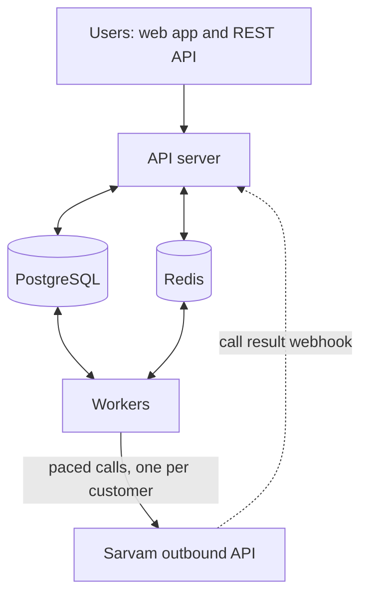

# Research and Approach

Before designing the Campaign Manager, I looked at how other voice and telephony platforms run outbound campaigns. This note covers what I found, what I took from it, how it shaped my architecture, the assumptions I am making, and what I will deliver.

## 1. How a real voice agent campaign works

This is one call from start to finish, based on the assignment and Sarvam's docs.

1. A business sets up a voice agent on Sarvam. The agent has an app id, a version, and a set of variables it needs, like `customer_name` or `emi_amount`.
2. The business uploads a list of customers. Each row has a phone number and a value for each of those variables.
3. When it is time, our system calls Sarvam's outbound API once for each customer. The request says which agent to use, which number to call from, which number to call, and that customer's variable values.
4. Sarvam dials the customer. The agent greets them with its opening message and talks to them using their details, for example reminding them their EMI is due.
5. When the call ends, Sarvam sends the result to our webhook: connected, busy, no answer or failed, plus how long the call lasted.
6. We decide what happens next. A good call is marked completed. A busy or unanswered call can be retried later, but only inside the allowed calling hours and only up to the retry limit.

Sarvam only handles step 4. Everything else is what I am building.

## 2. How others do it

There are two kinds of players in this space.

* **Telephony providers** own the phone lines. They connect to carriers, provide numbers, and actually ring the phone.
* **Voice AI platforms** provide the agent that talks and the tools to run campaigns. They sit on top of a telephony provider.

| Product | Type | How it limits speed | What happens over the limit | Retries | Scheduling |
| --- | --- | --- | --- | --- | --- |
| Vobiz | Telephony provider (India) | Two limits per phone line: calls per second and calls at the same time (example: 5 per second, 10 at once) | The call fails | Left to the platform on top | Left to the platform on top |
| Exotel | Telephony provider with campaigns | Calls per minute, 60 by default, shared by every campaign on the account | Calls wait in a queue | Up to 3 retries on busy, no answer or failed, with equal or growing gaps | Yes. Sends a result for each call, and one more when all attempts for a number are done |
| Vapi | Voice AI platform | Calls at the same time, 10 by default | Calls wait up to an hour for a free slot | Only within that hour | Up to 7 days ahead in 15 minute steps. Cannot be edited once scheduled |
| Retell | Voice AI platform | Calls at the same time (20 by default), plus a calls per second setting | Calls wait in a queue | Not clear from what I found | Batch calls |
| Bolna | Voice AI platform (India) | Calls at the same time, 10 by default | Not clear from the docs | A max retry count with a list of gaps, for example 15 then 30 minutes | A batch starts idle; its start time is rounded to 10 minutes |
| Sarvam | Voice AI platform (the reference) | Attempts per second, from 0.1 to 500. Retries count toward it | Not clear from the docs | Retry rules set on the campaign | Starts at a set time; customers can be added while it is running or paused |

The Retell numbers come from their community forum, not their official docs.

## 3. What I took from it and how it shapes my design

| What I noticed | What I took from it | How it shows up in my design |
| --- | --- | --- |
| Telephony providers limit both calls per second and calls happening at once | Speed and simultaneous calls are two different limits | The company confirmed by email that concurrency means how many calls run at the same time. Each organisation has both limits, calls at the same time and calls per second, checked together in one atomic step |
| Exotel shares one limit across all campaigns on an account | The limit belongs to the account, not to each campaign | One limit per organisation, shared by every campaign and every worker in it. Each campaign also has its own speed |
| Vobiz rejects calls over the limit | Hitting a limit and getting errors wastes calls and still counts as traffic | Calls are spaced out evenly so the limit is never hit. I never rely on error responses to slow down |
| Retry rules look almost the same everywhere | Retry on busy, no answer or failed, with a small max and growing gaps | Same rules, plus a "call too short" rule, and retries always land inside calling hours |
| Vapi campaigns get stuck at 10 calls and cannot be edited once scheduled. Their support suggested building your own queue on the single call API | Users want control over a running campaign | Pause, edit and resume at any time. My own queue on top of Sarvam's single call API |
| Vapi and Bolna schedule in 10 or 15 minute steps | Scheduling is coarse | Start times and calling windows work to the second |
| Vobiz advertises calling that follows Indian telecom rules (TRAI and DLT) | Calling hours matter in India | Calling windows with timezone, hours and days are a core feature, not an add on |
| Every platform reports call results later through a webhook | The outcome always arrives after the call | The webhook handler safely ignores duplicates and handles results that arrive late |

## 4. Architecture

| Layer | What it does |
| --- | --- |
| Web app (React) | Screens for organisations, agents, campaigns, CSV uploads and live progress. It uses the same API that anyone can call directly |
| API server (FastAPI) | Login and roles, creating campaigns, checking CSV uploads, start, pause, resume and stop, receiving Sarvam's webhooks, and pushing live updates to the browser |
| Workers | Pick the next customer who is due, get a send slot from Redis, call Sarvam, and save the result. You can run as many as you need. One of them also runs a check every second that starts scheduled campaigns, opens and closes calling windows, finishes campaigns, and cleans up after crashes |
| PostgreSQL | Stores everything. Every customer is a row with a status, and that table is the queue |
| Redis | The shared limiter for each organisation (calls at the same time and calls per second), the on/off switch for each campaign, and live update messages. If Redis is lost, it is rebuilt from PostgreSQL |
| Fake Sarvam (the only Sarvam we call) | Same API as Sarvam. It sends back made-up call results, can inject failures, and counts both calls per second and calls live at once, to prove both limits hold under load (`make prove`) |

The four ideas that hold it together:

1. **Nothing is queued ahead of time.** A customer stays a row in PostgreSQL until the moment they are called, so pause, stop and the end of calling hours take effect immediately.
2. **One shared limiter.** Redis keeps count of the calls in progress for each organisation and hands out evenly spaced send times, so both limits hold no matter how many workers are running.
3. **No customer is called twice by mistake.** A marker is saved just before each call. If a worker crashes, the marker tells us whether the call went out. If it might have, we wait for Sarvam's result instead of calling again.
4. **Retries go through the same path.** A retry is the same customer with a new time inside the next calling window. It goes through the same speed limiter as a first call.

## 5. Assumptions I am making

1. "Concurrency" in the brief means how many calls run at the same time; the company confirmed this by email. Each organisation has two limits, both set by the superadmin and enforced together: the most calls running at once, and the most calls to Sarvam in any one second (the brief's own example).
2. Every call counts toward those limits, including retries.
3. Each campaign also has its own speed. The real speed is the lower of the campaign's speed and what the organisation has left.
4. I can only use Sarvam's outbound call API, so agent details (app id, version, variables) are entered by hand in our app. The sample CSV is built from those details.
5. The Sarvam API key is stored per workspace, encrypted, and never shown again after it is saved.
6. Call results are classified like this: connected and long enough is completed; connected but shorter than the threshold is a short call; then busy, no answer and failed. If no result arrives within 15 minutes (a setting), the call is marked lost and treated like failed.
7. A retry is moved into the next allowed calling window. If that is after the campaign's end time, the customer is marked failed.
8. Each campaign has one calling window per day in one timezone. Windows that go past midnight are not supported for now.
9. A call that is already ringing cannot be stopped. Pause, stop and the end of calling hours only stop new calls.
10. By default, a CSV upload is rejected if any row is bad, and the user sees exactly which rows and why. There is an option to keep only the good rows. Phone numbers are stored in international format (+91...), and each number appears only once per campaign.
11. The same number is never called by two campaigns of the same organisation at the same time.
12. There are three roles: superadmin, organisation admin, and member.
13. Only mock calls are allowed, so every call goes to the fake Sarvam server and no real people are called. The system never calls the real Sarvam API, not even for the demo.

## 6. Deliverables

| Deliverable | What it will include | Planned |
| --- | --- | --- |
| GitHub repository | Full source code, with `docker compose up` starting everything in one command | Day 1 onward |
| Working app | Campaigns, CSV upload with sample download and validation, start, pause, resume and stop, live status, organisations, workspaces and roles. All available from both the UI and the API | Days 2 to 10 |
| Execution engine | Scheduling, calling windows, retries, webhook handling, and the per organisation limit holding with many workers | Days 5 to 7 |
| Tests | Unit tests for time and retry logic, tests with several workers running at once, and crash tests | Throughout, final pass Day 11 |
| README | Architecture diagram, key decisions and trade offs, assumptions, known limitations | Draft now, final Day 12 |
| API documentation | OpenAPI spec and a Postman collection | Day 12 |
| Demo video | One campaign end to end, and the organisation limit holding under load | Day 12 |

## Sources

* Vobiz: [SIP trunking API](https://docs.vobiz.ai/trunks), [make a call](https://docs.vobiz.ai/call/make-call), [CPS calculator](https://www.vobiz.ai/docs/resources/calculator)
* Exotel: [creating a campaign](https://developer.exotel.com/docs/campaign-guides/creating-voice-campaign), [retry logic](https://developer.exotel.com/docs/campaign-guides/campaign-retry-logic)
* Vapi: [scheduling and lifecycle](https://docs.vapi.ai/outbound-campaigns/scheduling-and-lifecycle), [call concurrency](https://docs.vapi.ai/calls/call-concurrency.md)
* Retell: [community thread on concurrency](https://community.retellai.com/t/questions-regarding-api-call-concurrency-batch-processing-and-call-latency/3376)
* Bolna: [batch calling](https://www.bolna.ai/docs/outbound/batch-calling), [limits](https://www.bolna.ai/docs/api-reference/limits)
* Sarvam: [campaigns](https://docs.sarvam.ai/conversations/deploy/campaigns.md), [outbound webhook](https://docs.sarvam.ai/api-reference/instant-outbound/webhook-payload)
